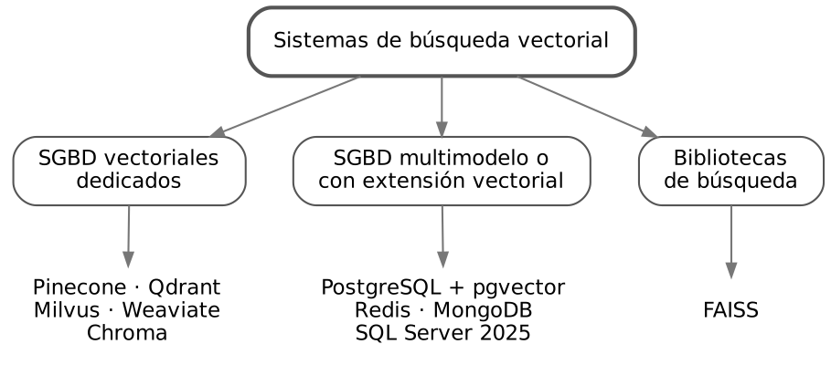
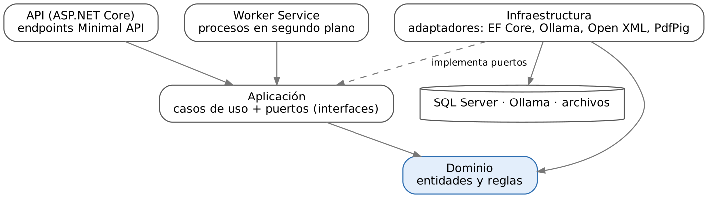
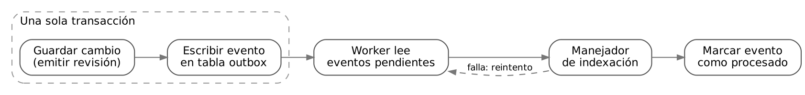
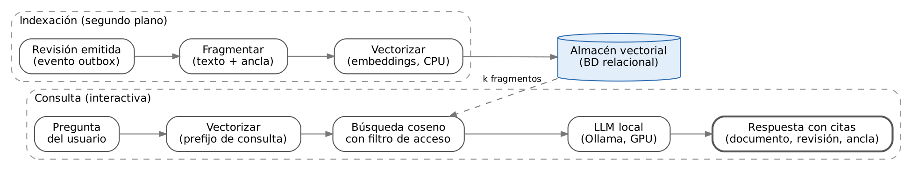
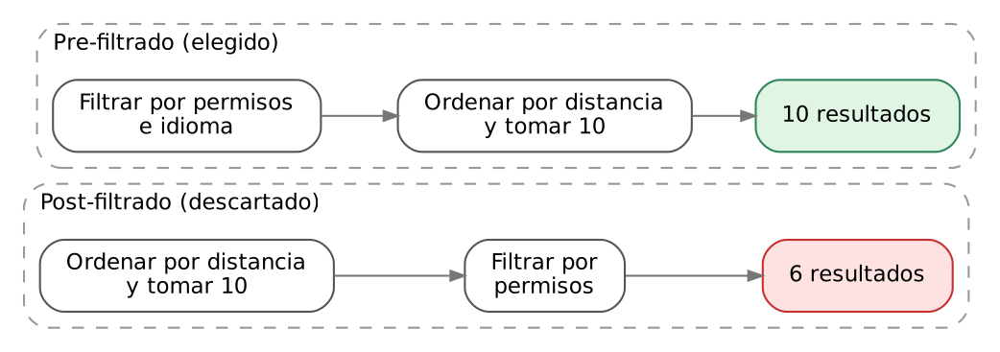

#+title: Diseño e implementación de un asistente conversacional basado en Generación Aumentada por Recuperación (RAG) para la consulta de documentación controlada en un sistema ERP de gestión de calidad
#+subtitle: Reporte final de residencia profesional
#+author: Alberto Emiliano Solis Santos
#+date: 2026
#+language: es
#+options: toc:nil title:nil num:t
#+latex_header: \usepackage[spanish,es-tabla]{babel}
#+latex_header: \usepackage[margin=2.5cm]{geometry}
#+latex_header: \usepackage{tabularx}
#+latex_header: \usepackage{array}
#+latex_header: \usepackage{float}
#+latex_header: \usepackage{xurl}
#+latex_header: \newcolumntype{Y}{>{\raggedright\arraybackslash}X}
#+latex_header: \addto\captionsspanish{\renewcommand{\contentsname}{Índice general}\renewcommand{\listfigurename}{Índice de imágenes}\renewcommand{\listtablename}{Índice de tablas}}
#+latex_header_extra: \hypersetup{hidelinks}
#+property: header-args:dot :eval no-export :exports results :cmdline -Tpng -Gdpi=150

# Borrador 2 (2026-11-25). Estructura según la plantilla de reporte de residencias
# que indicó el residente. Confidencialidad: solo información pública de la empresa
# (su sitio web); no incluir clientes, códigos de documentos, nombres de módulos,
# esquemas de base de datos ni código fuente.
# Diagramas: bloques Graphviz (dot). Para regenerarlos: instalar Graphviz, habilitar
# (org-babel-do-load-languages 'org-babel-load-languages '((dot . t))) y C-c C-c en cada
# bloque. Las imágenes ya generadas están en figuras/ (debe quedar junto a este archivo).

* Pendientes antes de entregar                                    :noexport:
- [ ] Insertar la hoja membretada oficial del Instituto Tecnológico de Celaya en lugar de la tabla de datos.
- [ ] Confirmar las fechas exactas de inicio y fin de la residencia.
- [ ] PENDIENTE: autorización de la empresa para publicar las mediciones del prototipo. La sección está marcada :noexport: y no sale en el PDF hasta quitar esa etiqueta.
- [ ] Llenar la columna "Resultado" de la tabla de métricas técnicas cuando se haga la corrida oficial.
- [ ] Verificar la tabla comparativa de bases vectoriales contra la documentación oficial.

* Hoja membretada con datos de la residencia
:PROPERTIES:
:UNNUMBERED: notoc
:END:
/[Sustituir por la hoja membretada oficial de la institución.]/

#+attr_latex: :environment tabularx :width \textwidth :align lY :placement [H]
| Institución         | Tecnológico Nacional de México, Instituto Tecnológico de Celaya, Campus II |
| Carrera             | Ingeniería en Sistemas Computacionales         |
| Título del proyecto | Diseño e implementación de un asistente conversacional basado en RAG para la consulta de documentación controlada en un sistema ERP de gestión de calidad |
| Residente           | Alberto Emiliano Solis Santos                  |
| Número de control   | 22030618                                       |
| Empresa             | G-ONE Auto Parts de México, S.A. de C.V.       |
| Departamento        | Tecnologías de la Información (TI)             |
| Asesor interno      | Juan Pablo Valencia Aguirre                    |
| Asesor externo      | Claudia Cristina Ortega González               |
| Periodo             | Julio a diciembre de 2026                      |

#+latex: \newpage
#+TOC: headlines 3
#+latex: \newpage
#+latex: \listoffigures
#+TOC: tables
#+latex: \newpage

* Introducción
:PROPERTIES:
:UNNUMBERED: t
:END:
#+latex: \addcontentsline{toc}{section}{Introducción}
Los sistemas de gestión de calidad en la industria manufacturera, como los basados en ISO 9001 o IATF 16949, exigen que cada operación se realice conforme a un documento controlado en su revisión vigente. Los sistemas ERP centralizan esos documentos, pero su consulta sigue dependiendo de búsquedas por código, título o palabra exacta.

Los modelos de lenguaje de gran escala (LLM) permiten formular preguntas en lenguaje natural, pero por sí solos desconocen la documentación interna de una organización y pueden generar respuestas plausibles pero falsas (alucinaciones). La arquitectura RAG (Lewis et al., 2020) resuelve ambas limitaciones al recuperar primero los fragmentos relevantes y entregarlos al modelo como contexto.

El presente reporte describe el trabajo realizado durante la residencia profesional: el análisis de alternativas, el diseño de la solución, su implementación incremental y el protocolo con el que se evalúa.

Las organizaciones de manufactura que operan bajo sistemas de gestión de calidad acumulan cientos de documentos controlados: procedimientos, instructivos y planes de inspección, con frecuencia en más de un idioma y con múltiples revisiones vigentes y obsoletas. Localizar la instrucción correcta exige conocer el código del documento o recorrerlo manualmente.

El proyecto consiste en el diseño e implementación de un asistente conversacional integrado a un sistema ERP de gestión de calidad, basado en la arquitectura de Generación Aumentada por Recuperación (RAG). Se eligió RAG sobre el ajuste fino porque no requiere reentrenar el modelo, incorpora documentos nuevos en cuanto se emiten y permite citar la fuente exacta de cada respuesta. El contenido de cada revisión se fragmenta, se convierte en vectores de 1024 dimensiones con un modelo de embeddings abierto y se almacena junto con los datos transaccionales; la búsqueda usa similitud coseno con el control de acceso aplicado dentro de la misma consulta. La generación se ejecuta con un modelo de lenguaje abierto servido localmente, sin enviar información a servicios externos.

La evaluación propone medir la calidad de recuperación con recall@10 sobre un conjunto de preguntas reales anonimizadas en dos idiomas, y la confiabilidad del llamado a herramientas como proporción de invocaciones con esquema válido.

*Palabras clave:* generación aumentada por recuperación, modelos de lenguaje, bases de datos vectoriales, búsqueda semántica, gestión de calidad, ERP.

El capítulo 1 describe la empresa, la problemática y los objetivos. El capítulo 2 presenta los fundamentos teóricos y las tecnologías utilizadas. El capítulo 3 detalla el método de trabajo y las actividades de los cuatro sprints. El capítulo 4 presenta los resultados y el capítulo 5 las conclusiones y recomendaciones.

* Generalidades del proyecto

** Marco de referencia

*** Empresa
G-ONE Auto Parts de México, S.A. de C.V. es un fabricante especializado en partes de la estructura de la carrocería automotriz. Su propósito declarado es fabricar una carrocería ligera y altamente rígida en cooperación con sus empresas matrices en Japón (G-ONE Auto Parts de México, s.f.-a). La empresa surge de la unión de dos fabricantes de autopartes; se estableció en el estado de Guanajuato en 2012 y comenzó operaciones en 2014.

Su producción diaria se rige por el lema "alta calidad, precio razonable y oportuno". Su política de calidad establece metas mensuales cuantificadas, entre ellas cero casos de calidad de rango A y B, y cero paros de línea del cliente por entregas (G-ONE Auto Parts de México, s.f.-b).

Tres rasgos de la empresa explican requisitos del asistente:

1. *Documentación en dos idiomas.* La cooperación con las matrices en Japón hace que parte de la documentación controlada exista en español y en japonés. Por ello la evaluación incluye preguntas en ambos idiomas.
2. *Exigencia de calidad.* Con metas de cero casos de calidad graves, una respuesta basada en una revisión obsoleta no es aceptable. De ahí los requisitos de trazabilidad y de indexar por revisión.
3. *Seguridad de la información.* La política de seguridad de la información de la empresa compromete la confidencialidad, integridad y disponibilidad de la información y el cumplimiento de los controles de ISO/IEC 27001 (G-ONE Auto Parts de México, s.f.-b). Por ello los modelos se ejecutan en servidores propios y ningún documento se envía a servicios externos.

*** Departamento
El departamento de Tecnologías de la Información (TI) administra la infraestructura de cómputo de la empresa y desarrolla sus sistemas internos. Entre ellos está el ERP de gestión de calidad, que concentra los procesos documentales y de calidad de la planta.

El departamento opera sus propios servidores, lo que permitió ejecutar los modelos de lenguaje dentro de la red de la empresa, en línea con su política de seguridad de la información.

*** Área de trabajo
La residencia se realizó en el equipo de desarrollo del ERP de gestión de calidad, dentro del departamento de TI. Ese sistema administra, entre otros procesos, el control documental: la emisión, revisión, aprobación y difusión de documentos controlados.

El residente se integró al equipo de desarrollo, con la responsabilidad de construir la capa de acceso a modelos de lenguaje y las funciones de búsqueda semántica y asistente. El despliegue en servidores lo realizó un desarrollador senior del equipo.

/[Se omiten los detalles internos del sistema, sus documentos y sus datos por confidencialidad.]/

** Problemática
En un entorno de calidad, una respuesta incorrecta no es solo un mal resultado: puede convertirse en evidencia falsa. Responder con una revisión obsoleta de un procedimiento, o con un documento que el usuario no tiene permiso de ver, tiene consecuencias de auditoría. Por ello el problema no es únicamente "responder preguntas sobre documentos", sino hacerlo con tres garantías, en orden de prioridad:

1. *Trazabilidad:* cada afirmación debe citar el documento, la revisión y la ubicación (página, hoja o fila) de donde proviene.
2. *Control de acceso:* la recuperación no debe revelar contenido fuera del alcance del usuario ni de su organización.
3. *Confidencialidad:* los documentos no deben salir de la infraestructura de la organización hacia servicios de terceros.

De este planteamiento se derivan cuatro preguntas que guían el proyecto:

- *P1.* ¿Es RAG una alternativa más adecuada que el ajuste fino para adaptar un LLM a documentación controlada que cambia con cada revisión?
- *P2.* ¿Qué tipo de almacenamiento vectorial (sistema dedicado o extensión de un motor relacional) satisface mejor los requisitos de exactitud, aislamiento y control de acceso?
- *P3.* ¿Qué tamaño de modelo de lenguaje es suficiente para responder con citas y llamar herramientas de forma confiable en hardware local con una sola GPU?
- *P4.* ¿Qué métrica de similitud (euclidiana, coseno o producto interno) conviene para comparar embeddings de texto?

** Objetivos

*** Objetivo general
Diseñar, implementar y evaluar un asistente conversacional basado en RAG que responda preguntas sobre la documentación controlada de un ERP de calidad, con citas verificables y respetando el control de acceso.

*** Objetivos específicos
1. Analizar las alternativas de adaptación de LLM (ajuste fino y RAG) y justificar la elección.
2. Comparar sistemas de bases de datos vectoriales y seleccionar uno con base en criterios técnicos.
3. Implementar un proceso de indexación que fragmente, vectorice y almacene el contenido de cada revisión.
4. Implementar la búsqueda semántica con el control de acceso integrado en la consulta.
5. Implementar la generación de respuestas con citas mediante un modelo servido localmente.
6. Evaluar la calidad de recuperación y la confiabilidad del llamado a herramientas.

** Justificación
El ajuste fino requiere conjuntos de entrenamiento, cómputo considerable y reentrenar cada vez que un documento cambia, lo que lo hace costoso en tiempo para documentación que se revisa continuamente. RAG evita el entrenamiento, refleja una nueva revisión en cuanto se indexa y, al conservar el texto recuperado, permite mostrar la fuente. La inferencia local elimina el riesgo de enviar documentos a proveedores externos.

** Alcances y restricciones

*** Alcances
- Indexación automática del contenido en prosa de cada revisión de documento controlado al emitirse.
- Búsqueda por significado, con cita del documento, la revisión y la ubicación del fragmento.
- Asistente que responde en lenguaje natural citando sus fuentes y que puede generar gráficas declaradas de barras y de líneas.
- Control de acceso por usuario y aislamiento entre organizaciones en toda recuperación.
- Ejecución de los modelos en servidores propios.

*** Limitaciones
- El asistente propone y consulta, pero no modifica registros por sí mismo.
- La evaluación se limita a español y japonés, los idiomas de la documentación del caso de estudio.
- La inferencia está limitada por una sola GPU compartida, lo que restringe la concurrencia.
- La interfaz gráfica del asistente no forma parte de este proyecto; se entregaron los servicios y endpoints que la pantalla consumirá.
- La instalación en servidores la realiza otro integrante del departamento; el residente entregó el código y la guía de despliegue.

* Marco teórico
El marco teórico reúne los fundamentos de modelos de lenguaje y recuperación semántica que sustentan la elección de RAG, y las tecnologías con las que se implementó el asistente.

** Fundamentos teóricos

*** Requisitos funcionales
Los requisitos funcionales describen lo que el sistema debe hacer (tabla [[tab:rf]]).

#+name: tab:rf
#+caption: Requisitos funcionales.
#+attr_latex: :environment tabularx :width \textwidth :align lY :placement [H]
| Clave | Requisito                                                                    |
|-------+------------------------------------------------------------------------------|
| RF1   | Indexar automáticamente cada revisión al emitirse                            |
| RF2   | Buscar por significado y devolver fragmentos con documento, revisión y ancla |
| RF3   | Responder en lenguaje natural citando las fuentes                            |
| RF4   | Invocar herramientas declaradas por cada módulo del sistema                  |

*** Requisitos no funcionales
Los requisitos no funcionales describen cómo debe comportarse el sistema: seguridad, disponibilidad y desempeño (tabla [[tab:rnf]]).

#+name: tab:rnf
#+caption: Requisitos no funcionales.
#+attr_latex: :environment tabularx :width \textwidth :align lY :placement [H]
| Clave | Requisito                                                                     |
|-------+-------------------------------------------------------------------------------|
| RNF1  | Ningún documento sale de la infraestructura propia                            |
| RNF2  | La búsqueda respeta el alcance de lectura del usuario y la organización       |
| RNF3  | La ausencia del servidor de modelos no rompe el resto del sistema             |
| RNF4  | Respuesta de búsqueda en menos de 200 ms con 10,000 vectores por organización |

*** Modelos de lenguaje de gran escala
Un LLM es una red neuronal basada en la arquitectura Transformer (Vaswani et al., 2017) que, entrenada sobre grandes corpus, predice el siguiente token de una secuencia. Su conocimiento queda fijo en los pesos al terminar el entrenamiento, y su ventana de contexto limita cuánta información adicional puede recibir en una consulta.

El tamaño del modelo, medido en miles de millones de parámetros (B), determina su capacidad de razonamiento y la memoria de GPU que requiere. Un modelo de 27B en precisión cuantizada de 4 bits ocupa del orden de 15 a 18 GB, lo que deja poco margen en una GPU de 24 GB para la caché de atención (/KV cache/) y, por tanto, para atender varias consultas en paralelo. El tamaño adecuado no se elige por intuición sino midiendo, con el mismo conjunto de preguntas, cuál es el modelo más pequeño que cumple la tarea (véase [[*Resultados obtenidos]]).

*** Embeddings de texto
Un embedding es un vector de números reales de dimensión fija que representa el significado de un texto, de modo que textos con significado similar quedan cerca en el espacio vectorial. Los modelos de embeddings actuales son multilingües: una pregunta en español puede quedar cerca de su respuesta escrita en japonés.

Dos propiedades son relevantes para el diseño:
- *La dimensión es una decisión de esquema.* Cambiar de modelo puede cambiar la dimensión y obliga a revectorizar todo el corpus, por lo que debe validarse antes de fijarla.
- *Asimetría consulta-documento.* Muchos modelos esperan un prefijo de instrucción en la consulta pero no en el documento. Omitirlo no produce un error: degrada la recuperación en silencio.

*** Métricas de similitud
Sean dos vectores \(\mathbf{a}\) y \(\mathbf{b}\) de dimensión \(n\). La *distancia euclidiana* mide la longitud del segmento que los une:

\[ d_E(\mathbf{a},\mathbf{b}) = \sqrt{\sum_{i=1}^{n} (a_i - b_i)^2} \]

La *similitud coseno* mide el ángulo entre ellos e ignora su magnitud:

\[ \cos(\mathbf{a},\mathbf{b}) = \frac{\mathbf{a}\cdot\mathbf{b}}{\lVert\mathbf{a}\rVert\,\lVert\mathbf{b}\rVert} \]

Cuando los vectores están normalizados a longitud 1, ambas medidas ordenan los resultados de la misma forma, porque:

\[ d_E(\mathbf{a},\mathbf{b})^2 = 2 - 2\cos(\mathbf{a},\mathbf{b}) \]

En ese caso el producto interno coincide con el coseno y es la operación más barata. Taipalus (2024) señala además que en dimensiones altas las distancias euclidianas tienden a concentrarse, lo que reduce su poder de discriminación; por eso los modelos de embeddings de texto suelen entrenarse y evaluarse con coseno. Este proyecto usa distancia coseno.

La tabla [[tab:metricas]] resume las métricas.

#+name: tab:metricas
#+caption: Métricas de similitud entre vectores.
#+attr_latex: :environment tabularx :width \textwidth :align lllY :placement [H]
| Métrica              | Fórmula                                                                            | Rango                | Interpretación                                              |
|----------------------+------------------------------------------------------------------------------------+----------------------+-------------------------------------------------------------|
| Distancia euclidiana | \(\lVert\mathbf{a}-\mathbf{b}\rVert\)                                              | \([0,\infty)\)       | Menor es más parecido; sensible a la magnitud               |
| Similitud coseno     | \(\frac{\mathbf{a}\cdot\mathbf{b}}{\lVert\mathbf{a}\rVert\lVert\mathbf{b}\rVert}\) | \([-1,1]\)           | Mayor es más parecido; solo considera el ángulo             |
| Distancia coseno     | \(1-\cos(\mathbf{a},\mathbf{b})\)                                                  | \([0,2]\)            | Forma de distancia del coseno; la usa el motor para ordenar |
| Producto interno     | \(\mathbf{a}\cdot\mathbf{b}\)                                                      | \((-\infty,\infty)\) | Igual al coseno si los vectores están normalizados          |

*** Ajuste fino frente a RAG
Existen dos formas principales de especializar un LLM en un dominio (tabla [[tab:ft-rag]]).

#+name: tab:ft-rag
#+attr_latex: :environment tabularx :width \textwidth :align lYY :placement [H]
#+caption: Comparación entre ajuste fino y RAG para documentación controlada.
| Criterio                     | Ajuste fino (fine-tuning)                   | RAG                                   |
|------------------------------+---------------------------------------------+---------------------------------------|
| Entrenamiento                | Requiere datos etiquetados y cómputo de GPU | No requiere entrenar                  |
| Documento nuevo o revisado   | Reentrenar                                  | Indexar el documento                  |
| Cita de la fuente            | No es posible: el conocimiento queda en los pesos | El fragmento recuperado se muestra |
| Control de acceso por usuario | No es posible filtrar lo aprendido         | Se filtra en la recuperación          |
| Riesgo de alucinación        | Persiste                                    | Se reduce al anclar al contexto       |
| Costo principal              | Entrenamiento                               | Almacenamiento e indexación           |

Para documentación controlada, los criterios de cita y control de acceso son decisivos: un modelo ajustado no puede demostrar de qué revisión proviene una respuesta ni olvidar lo que un usuario no debe ver.

La figura [[fig:rag-vs-ft]] muestra la diferencia práctica: ante una nueva revisión, el ajuste fino exige volver a entrenar, mientras que RAG solo indexa el documento.

#+name: dot-rag-vs-ft
#+begin_src dot :file figuras/rag-vs-ft.png
digraph ragft {
  graph [fontname="Helvetica", fontsize=11, nodesep=0.35, ranksep=0.45, bgcolor="white"];
  node [shape=box, style="rounded", fontname="Helvetica", fontsize=11, color="#555555", margin="0.18,0.08"];
  edge [color="#777777", fontname="Helvetica", fontsize=9, arrowsize=0.7];
  rankdir=LR;
  subgraph cluster_ft { label="Ajuste fino"; labeljust=l; style="rounded,dashed"; color="#999999";
    d1 [label="Datos de\nentrenamiento"]; t1 [label="Entrenamiento\n(GPU, horas o días)"]; m1 [label="Modelo ajustado\n(conocimiento en pesos)"]; r1 [label="Respuesta\nsin fuente"];
    d1 -> t1 -> m1 -> r1; }
  subgraph cluster_rag { label="RAG"; labeljust=l; style="rounded,dashed"; color="#999999";
    d2 [label="Documentos"]; i2 [label="Índice\nvectorial", shape=cylinder]; p2 [label="Pregunta"]; s2 [label="Recuperación\nde fragmentos"]; m2 [label="LLM base\n+ contexto"]; r2 [label="Respuesta\ncon cita", style="rounded,bold"];
    d2 -> i2 -> s2; p2 -> s2 -> m2 -> r2; }
  rev [label="Nueva revisión\ndel documento", shape=note];
  rev -> t1 [label=" reentrenar", style=dashed];
  rev -> i2 [label=" indexar", style=dashed];
}
#+end_src

#+name: fig:rag-vs-ft
#+caption: Flujo de ajuste fino frente a RAG ante una nueva revisión documental.
#+attr_latex: :width \textwidth :placement [H]
#+RESULTS: dot-rag-vs-ft
[[file:figuras/rag-vs-ft.png]]

*** Fragmentación de documentos
Los documentos se dividen en fragmentos (/chunks/) porque el modelo de embeddings tiene un límite de tokens y porque un vector de un documento completo diluye su significado. Las estrategias comunes son por tamaño fijo con traslape, por estructura (títulos, párrafos, filas de tabla) y semánticas. Cada fragmento debe conservar un *ancla*: la página, hoja o fila de origen, que es lo que convierte la respuesta en una cita verificable.

*** Búsqueda de vecinos más cercanos
La búsqueda exacta (k-NN) compara la consulta con todos los vectores: su costo crece linealmente pero el resultado es exacto. Los índices aproximados (ANN) como HNSW (Malkov y Yashunin, 2018), los basados en cuantización de producto (Jégou et al., 2011) o en hashing sensible a la localidad sacrifican exactitud por velocidad. Taipalus (2024) indica que los índices sin pérdida se prefieren cuando la exactitud es crítica.

*** Sistemas gestores de bases de datos vectoriales
Taipalus (2024) distingue tres familias: los *sistemas vectoriales dedicados* (Pinecone, Qdrant, Milvus, Weaviate, Chroma), los *sistemas multimodelo o con extensión vectorial* sobre un motor existente (PostgreSQL con pgvector, Redis, MongoDB) y las *bibliotecas* de búsqueda como FAISS, que no ofrecen funciones propias de un gestor (transacciones, persistencia, control de acceso). Las consultas híbridas, que combinan similitud vectorial con filtros sobre metadatos, son el caso típico en aplicaciones empresariales.

La figura [[fig:taxonomia]] resume esa clasificación.

#+name: dot-taxonomia
#+begin_src dot :file figuras/taxonomia.png
digraph tax {
  graph [fontname="Helvetica", fontsize=11, nodesep=0.35, ranksep=0.45, bgcolor="white"];
  node [shape=box, style="rounded", fontname="Helvetica", fontsize=11, color="#555555", margin="0.18,0.08"];
  edge [color="#777777", fontname="Helvetica", fontsize=9, arrowsize=0.7];
  rankdir=TB;
  root [label="Sistemas de búsqueda vectorial", style="rounded,bold"];
  a [label="SGBD vectoriales\ndedicados"]; b [label="SGBD multimodelo o\ncon extensión vectorial"]; c [label="Bibliotecas\nde búsqueda"];
  a1 [label="Pinecone · Qdrant\nMilvus · Weaviate\nChroma", shape=plaintext]; b1 [label="PostgreSQL + pgvector\nRedis · MongoDB\nSQL Server 2025", shape=plaintext]; c1 [label="FAISS", shape=plaintext];
  root -> {a b c}; a -> a1; b -> b1; c -> c1;
}
#+end_src

#+name: fig:taxonomia
#+caption: Clasificación de los sistemas de búsqueda vectorial. Elaboración propia con base en Taipalus (2024); SQL Server 2025 se agrega como extensión vectorial.
#+attr_latex: :width 0.8\textwidth :placement [H]
#+RESULTS: dot-taxonomia

*** Llamado a herramientas
Los LLM recientes pueden emitir, en lugar de texto, una invocación estructurada (JSON) a una función declarada por la aplicación. Esto permite que el asistente consulte el índice o datos exactos del sistema. La aplicación debe validar el esquema de cada llamada y verificar que el usuario tenga permiso para la herramienta invocada.

** Estructura de una aplicación ASP.NET Core
El asistente forma parte de una aplicación web construida con ASP.NET Core. Esta sección describe cómo se organiza una aplicación de este tipo.

*** ASP.NET Core
ASP.NET Core es el marco de trabajo de .NET para construir aplicaciones web y API HTTP (Microsoft, s.f.-c). Una aplicación se arma en dos fases: primero se registran los servicios en un contenedor de dependencias y después se configura la /canalización de middleware/, una cadena de componentes por la que pasa cada petición (autenticación, autorización, manejo de errores, enrutamiento) antes de llegar al código que la atiende.

*** API REST y endpoints
REST (/Representational State Transfer/) es un estilo de arquitectura para sistemas distribuidos en el que los recursos se identifican con URL y se manipulan con los métodos de HTTP (Fielding, 2000). Un /endpoint/ es la combinación de una ruta y un método HTTP que la aplicación expone, por ejemplo =POST /api/v1/assistant/search=.

El asistente expone tres endpoints agrupados bajo un mismo prefijo versionado:

#+attr_latex: :environment tabularx :width \textwidth :align llY :placement [H]
#+caption: Endpoints del asistente.
| Método | Ruta relativa    | Función                                                                  |
|--------+------------------+--------------------------------------------------------------------------|
| GET    | =/availability=  | Indica si hay modelo configurado, para que la interfaz no ofrezca una función que fallaría |
| POST   | =/search=        | Búsqueda semántica: devuelve fragmentos con documento, revisión y ancla  |
| POST   | =/ask=           | Pregunta en lenguaje natural: devuelve una respuesta con citas           |

Se agruparon bajo el prefijo del asistente, y no bajo el de documentos, porque lo que se habilita o restringe por organización es la capacidad de inteligencia artificial: una organización con documentos pero sin modelo tendría un endpoint que siempre falla.

*** Controladores frente a Minimal APIs
ASP.NET Core ofrece dos formas de definir endpoints (Microsoft, s.f.-d):
- *Controladores:* clases que heredan de =ControllerBase=, donde cada método público es una acción asociada a una ruta mediante atributos. Es el modelo tradicional MVC.
- *Minimal APIs:* los endpoints se declaran como funciones (/lambdas/) asociadas a una ruta con métodos como =MapGet= y =MapPost=, y se organizan en grupos de rutas (=MapGroup=) que comparten prefijo, autorización y filtros.

El sistema usa Minimal APIs. Tienen menos código de infraestructura, las dependencias se reciben directamente como parámetros de cada función y el grupo de rutas permite aplicar en un solo lugar la autorización y la restricción por capacidad contratada. El siguiente ejemplo genérico ilustra la forma:

#+name: lst:minimal
#+begin_src csharp
var grupo = app.MapGroup("/api/v1/asistente")
               .RequireAuthorization();

grupo.MapPost("/buscar", async (PeticionBusqueda peticion,
                                IServicioBusqueda servicio,
                                CancellationToken ct) =>
{
    var resultados = await servicio.BuscarAsync(
        peticion.Pregunta, peticion.Cantidad, ct);
    return Results.Ok(resultados);
});
#+end_src

*** Inyección de dependencias y configuración
La /inyección de dependencias/ consiste en que un componente recibe los servicios que necesita en lugar de crearlos, lo que permite sustituirlos en pruebas o cambiar su implementación sin modificar a quien los usa (Fowler, 2004). .NET incluye un contenedor de dependencias en el que cada servicio se registra con un tiempo de vida: único para toda la aplicación (/singleton/), uno por petición (/scoped/) o uno nuevo cada vez (/transient/).

La configuración del modelo (direcciones del servidor, nombres de modelos, dimensión de los vectores) se lee de archivos JSON y variables de entorno mediante el /patrón Options/, que la convierte en un objeto tipado y la valida al iniciar. Si la sección está vacía, el sistema interpreta que la instalación no tiene modelo, un estado válido en el que el resto del ERP sigue funcionando.

#+name: tab:di
#+caption: Tiempos de vida en el contenedor de dependencias de .NET.
#+attr_latex: :environment tabularx :width \textwidth :align lYY :placement [H]
| Tiempo de vida | Instancias                               | Uso típico                                                                |
|----------------+------------------------------------------+---------------------------------------------------------------------------|
| Singleton      | Una para toda la aplicación              | Configuración validada, fábrica de clientes HTTP                          |
| Scoped         | Una por petición o por mensaje procesado | Contexto de base de datos (DbContext), contexto de la organización actual |
| Transient      | Una nueva cada vez que se pide           | Servicios ligeros sin estado                                              |

*** Arquitectura en capas y puertos y adaptadores
El sistema sigue una arquitectura limpia (Martin, 2017) organizada en capas:
- *Dominio:* entidades y reglas de negocio, sin dependencias externas.
- *Aplicación:* casos de uso y los /puertos/, interfaces que declaran lo que la aplicación necesita del exterior.
- *Infraestructura:* los /adaptadores/ que implementan esos puertos con una tecnología concreta (base de datos, servidor de modelos, archivos).

Es el patrón de puertos y adaptadores, o arquitectura hexagonal (Cockburn, 2005). En el asistente, el acceso al modelo de lenguaje se declaró como un puerto independiente del proveedor, y Ollama es solo uno de sus adaptadores; cambiar de servidor de inferencia no afecta a los casos de uso.

El sistema es además un /monolito modular/: una sola aplicación desplegable dividida en módulos con fronteras explícitas, en el que cada módulo es dueño de sus datos. Por eso el asistente declara el contrato de una herramienta, pero cada módulo implementa las herramientas sobre sus propios datos.

La figura [[fig:capas]] muestra el sentido de las dependencias: todas apuntan hacia el dominio, y la infraestructura depende de la aplicación porque implementa sus puertos.

#+name: dot-capas
#+begin_src dot :file figuras/capas.png
digraph capas {
  graph [fontname="Helvetica", fontsize=11, nodesep=0.35, ranksep=0.45, bgcolor="white"];
  node [shape=box, style="rounded", fontname="Helvetica", fontsize=11, color="#555555", margin="0.18,0.08"];
  edge [color="#777777", fontname="Helvetica", fontsize=9, arrowsize=0.7];
  rankdir=TB;
  api [label="API (ASP.NET Core)\nendpoints Minimal API"]; worker [label="Worker Service\nprocesos en segundo plano"];
  app [label="Aplicación\ncasos de uso + puertos (interfaces)"];
  dom [label="Dominio\nentidades y reglas", style="rounded,filled", fillcolor="#e3eefb", color="#2b6cb0"];
  infra [label="Infraestructura\nadaptadores: EF Core, Ollama, Open XML, PdfPig"];
  ext [label="SQL Server · Ollama · archivos", shape=cylinder];
  api -> app; worker -> app; app -> dom; infra -> app [label=" implementa puertos", style=dashed]; infra -> dom; infra -> ext;
  { rank=same; api; worker; }
}
#+end_src

#+name: fig:capas
#+caption: Capas de la arquitectura y sentido de sus dependencias.
#+attr_latex: :width 0.85\textwidth :placement [H]
#+RESULTS: dot-capas

*** Diseño guiado por el dominio
Del diseño guiado por el dominio (/Domain-Driven Design/, Evans, 2003) se tomó el concepto de /agregado/: un grupo de objetos que se modifica como una unidad a través de una raíz. El conjunto de fragmentos de una revisión es un agregado: reindexar sustituye todos sus fragmentos en una sola operación, y la raíz lleva los datos de auditoría.

** Autenticación en aplicaciones web
Las peticiones se autentican con /JSON Web Tokens/ (JWT), un formato estándar de credencial firmada que transporta la identidad del usuario y su organización (Jones et al., 2015). Sobre esa identidad se aplican dos controles: un permiso por acción (buscar requiere un permiso más amplio que preguntar, porque preguntar ocupa la GPU compartida) y una capacidad contratada por organización.

Los errores se devuelven con el formato /Problem Details/ para API HTTP (Nottingham et al., 2023). Cuando el servidor de modelos no responde, un manejador de excepciones traduce el error a una respuesta =503 Service Unavailable=, que distingue "el servicio no está disponible ahora" de un error del sistema.

La figura [[fig:middleware]] muestra el recorrido de una petición al asistente y la tabla [[tab:http]] los códigos de respuesta que puede recibir.

#+name: dot-middleware
#+begin_src dot :file figuras/middleware.png
digraph mw {
  graph [fontname="Helvetica", fontsize=11, nodesep=0.35, ranksep=0.45, bgcolor="white"];
  node [shape=box, style="rounded", fontname="Helvetica", fontsize=11, color="#555555", margin="0.18,0.08"];
  edge [color="#777777", fontname="Helvetica", fontsize=9, arrowsize=0.7];
  rankdir=LR;
  p [label="Petición\nHTTP", shape=plaintext]; e [label="Manejador de\nexcepciones"]; au [label="Autenticación\n(JWT)"]; az [label="Autorización\n(permiso + capacidad)"]; en [label="Endpoint\n(Minimal API)"]; s [label="Servicio\nde aplicación"];
  r401 [label="401\nsin identidad", shape=plaintext, fontsize=10]; r403 [label="403\nsin permiso", shape=plaintext, fontsize=10]; r503 [label="503\nexcepción: servidor\nde modelos no disponible", shape=plaintext, fontsize=10];
  p -> e -> au -> az -> en -> s [weight=10];
  au -> r401 [style=dashed]; az -> r403 [style=dashed]; e -> r503 [style=dashed];
  { rank=same; e; r503; } { rank=same; au; r401; } { rank=same; az; r403; }
}
#+end_src

#+name: fig:middleware
#+caption: Canalización de middleware de una petición al asistente.
#+attr_latex: :width \textwidth :placement [H]
#+RESULTS: dot-middleware
[[file:figuras/middleware.png]]

#+name: tab:http
#+caption: Códigos de respuesta HTTP del asistente.
#+attr_latex: :environment tabularx :width \textwidth :align llY :placement [H]
| Código | Nombre              | Cuándo se devuelve                                                                            |
|--------+---------------------+-----------------------------------------------------------------------------------------------|
| 200    | OK                  | La búsqueda o la respuesta se generó correctamente                                            |
| 400    | Bad Request         | La petición no cumple el formato (por ejemplo, pregunta vacía)                                |
| 401    | Unauthorized        | No hay token válido                                                                           |
| 403    | Forbidden           | El usuario no tiene el permiso de buscar o preguntar                                          |
| 404    | Not Found           | La organización no tiene contratada la capacidad de IA: el grupo de rutas no existe para ella |
| 503    | Service Unavailable | El servidor de modelos no responde o está ocupado                                             |

** Procesos en segundo plano
El /patrón outbox/ resuelve el problema de guardar un cambio y publicar un evento de forma consistente: el evento se escribe en una tabla de la misma base de datos, dentro de la misma transacción que el cambio, y un proceso aparte lo lee y lo entrega después (Richardson, 2018). Así no puede existir un documento emitido cuyo evento de indexación se haya perdido.

Ese proceso aparte es un /Worker Service/ de .NET: una aplicación sin interfaz que ejecuta servicios en segundo plano (=BackgroundService=) de forma continua (Microsoft, s.f.-i). El indexado y las tareas encargadas al asistente se ejecutan ahí, con su propia instancia de Ollama, para no competir con las consultas interactivas.

La figura [[fig:outbox]] muestra el patrón aplicado a la indexación: si el manejador falla, el evento sigue pendiente y se reintenta.

#+name: dot-outbox
#+begin_src dot :file figuras/outbox.png
digraph outbox {
  graph [fontname="Helvetica", fontsize=11, nodesep=0.35, ranksep=0.45, bgcolor="white"];
  node [shape=box, style="rounded", fontname="Helvetica", fontsize=11, color="#555555", margin="0.18,0.08"];
  edge [color="#777777", fontname="Helvetica", fontsize=9, arrowsize=0.7];
  rankdir=LR;
  subgraph cluster_tx { label="Una sola transacción"; labeljust=l; style="rounded,dashed"; color="#999999";
    c [label="Guardar cambio\n(emitir revisión)"]; o [label="Escribir evento\nen tabla outbox"]; c -> o; }
  w [label="Worker lee\neventos pendientes"]; h [label="Manejador\nde indexación"]; m [label="Marcar evento\ncomo procesado"];
  o -> w -> h -> m;
  h -> w [label=" falla: reintento", style=dashed, constraint=false];
}
#+end_src

#+name: fig:outbox
#+caption: Patrón outbox aplicado a la indexación de una revisión.
#+attr_latex: :width \textwidth :placement [H]
#+RESULTS: dot-outbox

** Lectura de archivos
Para extraer el texto de los documentos se usaron dos bibliotecas de código abierto:
- *Open XML SDK*, para archivos de procesador de texto y hojas de cálculo en formato Office Open XML, estándar ISO/IEC 29500 (Microsoft, s.f.-j).
- *PdfPig*, para leer el texto y su página de origen en archivos PDF (PdfPig, s.f.).

Ambas permiten conservar el ancla de cada fragmento: página en PDF, hoja y fila en hojas de cálculo.

** Acceso a datos y al servidor de modelos

*** Entity Framework Core y LINQ
Entity Framework Core (EF Core) es el mapeador objeto-relacional (ORM) de .NET: traduce clases de C# a tablas y consultas escritas en LINQ a SQL (Microsoft, s.f.-f). LINQ (/Language Integrated Query/) permite escribir consultas con la sintaxis del propio lenguaje, verificadas por el compilador.

El proyecto usa EF Core 10, que puede expresar la distancia vectorial dentro de una consulta LINQ. Esto permitió escribir en una sola sentencia el filtro de acceso, el filtro de idioma y el ordenamiento por distancia coseno, que es la propiedad que se discute en la sección de seguridad en la recuperación. Dos detalles de EF Core condicionaron el diseño:
- *Propiedades en la sombra:* el vector se mapeó como una propiedad que existe en el modelo de EF pero no en la clase de dominio, para que el dominio no dependa de un tipo propio del proveedor de base de datos.
- *Orden de las operaciones:* ordenar después de proyectar el resultado a otro tipo no se puede traducir a SQL; el ordenamiento debe ir antes de la proyección.

*** SQL Server y el tipo vectorial nativo
SQL Server es el sistema gestor de bases de datos relacional del sistema. Su versión 2025 incorpora un tipo de dato =vector= de dimensión fija y la función =VECTOR_DISTANCE=, que calcula distancia coseno, euclidiana o de producto punto (Microsoft, s.f.-g). Esto permitió guardar los embeddings en la misma base que los documentos, con integridad referencial hacia la revisión de la que provienen.

El aislamiento entre organizaciones se apoya en la *seguridad a nivel de fila* (/Row-Level Security/, RLS): predicados definidos en la base de datos que filtran automáticamente las filas según un valor de contexto de la sesión, en este caso la organización del usuario (Microsoft, s.f.-h). Como el filtro lo aplica el motor, una consulta mal escrita en la aplicación no puede leer datos de otra organización.

*** Cliente HTTP hacia el servidor de modelos
La comunicación con Ollama se hace por su API REST: =/api/embed= para obtener embeddings y =/api/chat= para generar respuestas con herramientas (Ollama, s.f.). Se usó =IHttpClientFactory=, que administra la reutilización de conexiones y evita el agotamiento de sockets que ocurre al crear y desechar clientes HTTP repetidamente (Microsoft, s.f.-e). Se registraron dos clientes con nombre, uno por cada instancia de Ollama (interactiva y diferida), cada uno con su propio límite de tiempo.

** Herramientas utilizadas
La tabla [[tab:herramientas]] resume las herramientas con las que se construyó el asistente; las secciones siguientes describen cada una.

#+name: tab:herramientas
#+caption: Herramientas utilizadas.
#+attr_latex: :environment tabularx :width \textwidth :align lllY :placement [H]
| Herramienta           | Versión       | Tipo                   | Uso en el proyecto                                 |
|-----------------------+---------------+------------------------+----------------------------------------------------|
| .NET y C#             | 10            | Plataforma y lenguaje  | Todo el código del asistente                       |
| ASP.NET Core          | 10            | Marco web              | Endpoints del asistente                            |
| Entity Framework Core | 10.0.2        | ORM                    | Consultas vectoriales y persistencia de fragmentos |
| SQL Server            | 2025          | Base de datos          | Almacén vectorial y datos del ERP                  |
| Ollama                | —             | Servidor de inferencia | Embeddings y generación con modelos abiertos       |
| Open XML SDK          | 3.5.1         | Biblioteca             | Lectura de documentos de texto y hojas de cálculo  |
| PdfPig                | 0.1.16        | Biblioteca             | Lectura de PDF por página                          |
| xUnit                 | 2.9.3         | Marco de pruebas       | Pruebas unitarias, de arquitectura e integración   |

*** .NET y C#
.NET es una plataforma de desarrollo de código abierto y multiplataforma mantenida por Microsoft, que incluye un entorno de ejecución administrado (CLR), una biblioteca base de clases y herramientas de compilación (Microsoft, s.f.-a). El proyecto usa .NET 10, versión con soporte a largo plazo (LTS), y el lenguaje C#, de tipado estático y orientado a objetos con elementos funcionales.

Tres características del lenguaje fueron relevantes en el proyecto:
- *Tipos de referencia anulables:* el compilador advierte cuando un valor puede ser nulo y no se comprueba, lo que reduce errores en tiempo de ejecución.
- *Registros (=record=) y miembros obligatorios (=required=):* permiten definir objetos inmutables para las peticiones y respuestas, y obligan a quien los crea a llenar los campos esenciales. En el asistente, por ejemplo, el propósito de una petición de embedding (consulta o documento) es obligatorio, de modo que olvidar la asimetría descrita en la sección de embeddings produce un error de compilación en lugar de una degradación silenciosa.
- *Programación asíncrona (=async=/=await=):* las llamadas al servidor de modelos y a la base de datos son operaciones de entrada y salida; hacerlas asíncronas libera el hilo mientras se espera la respuesta y permite cancelarlas con un =CancellationToken= cuando el cliente se desconecta.

*** SQL Server
SQL Server es el sistema gestor de bases de datos relacional de Microsoft. Se usó por ser la base de datos del ERP y porque su versión 2025 incorpora el tipo =vector=, descrito en la sección de acceso a datos.

*** Ollama
Ollama es un servidor de código abierto para ejecutar modelos de lenguaje abiertos en equipos propios. Expone una API REST para obtener embeddings y generar texto, y administra la carga de los modelos en la GPU y la cola de peticiones (Ollama, s.f.). Permitió cumplir el requisito de que ningún documento salga de la infraestructura de la empresa.

*** Open XML SDK y PdfPig
Bibliotecas de código abierto para leer el contenido de los documentos. Se describen en la sección de lectura de archivos.

*** xUnit
Las pruebas se escribieron con xUnit, un marco de pruebas para .NET (xUnit.net, s.f.), en tres niveles (tabla [[tab:pruebas]]).

#+name: tab:pruebas
#+caption: Niveles de pruebas automatizadas.
#+attr_latex: :environment tabularx :width \textwidth :align lYY :placement [H]
| Nivel           | Qué verifica                                                                   | Ejemplo en el asistente                                              |
|-----------------+--------------------------------------------------------------------------------+----------------------------------------------------------------------|
| Unitarias       | Una clase aislada, con sus dependencias sustituidas                            | El cliente de Ollama con respuestas HTTP simuladas                   |
| De arquitectura | Reglas de diseño, inspeccionando los ensamblados compilados mediante reflexión | Que ninguna capa de dominio referencie tipos de la base de datos     |
| De integración  | El comportamiento contra una base de datos real                                | Que la consulta vectorial se traduzca a SQL y respete el aislamiento |

La cobertura se midió con Coverlet.

** Herramientas complementarias

*** Analizadores de código
Los analizadores de Roslyn, el compilador de C#, inspeccionan el código durante la compilación y reportan problemas de calidad, seguridad o estilo (Microsoft, s.f.-b). En el proyecto se configuraron como errores y no como avisos, de modo que el código no compila mientras no cumpla las reglas. Además se usó un analizador de API prohibidas para impedir llamadas a métodos considerados inseguros dentro del sistema.

*** OpenAPI
OpenAPI es una especificación estándar para describir API HTTP en un documento legible por máquinas (OpenAPI Initiative, 2024). ASP.NET Core genera ese documento a partir de los endpoints declarados, lo que permite probarlos y generar clientes sin escribir la documentación a mano.

*** Coverlet
Coverlet es una herramienta de código abierto que mide la cobertura de código de las pruebas en .NET, es decir, qué porcentaje del código se ejecuta durante las pruebas.

*** Org mode y Graphviz
Este reporte se redactó en Org mode, el formato de documentos de texto plano de Emacs, que permite exportar a PDF mediante LaTeX. Los diagramas se describen como texto en el lenguaje DOT y se dibujan con Graphviz, lo que permite versionarlos y modificarlos junto con el documento.

*** Emacs, Git y la CLI de .NET
- *Emacs:* editor de texto extensible con el que se escribió el código y este reporte, este último en Org mode.
- *Git:* sistema de control de versiones distribuido, usado para registrar los cambios de cada sprint y trabajar en ramas separadas del código principal.
- *CLI de .NET (=dotnet=):* herramienta de línea de comandos para compilar la solución y ejecutar las suites de pruebas (=dotnet build=, =dotnet test=).

** Trabajos relacionados
Tres trabajos recientes sirven de referencia para este proyecto: una revisión general de RAG, un reporte de experiencia sobre construir sistemas RAG a partir de documentos PDF y una revisión sistemática de RAG en un dominio regulado.

*** Revisión general de RAG
Gao et al. (2023) revisan la evolución de RAG y la organizan en tres paradigmas: /RAG ingenuo/ (indexar, recuperar y generar), /RAG avanzado/, que agrega pasos antes y después de la recuperación, como la optimización de la consulta o el reordenamiento de resultados, y /RAG modular/, que permite intercambiar componentes y combinarlos en flujos iterativos o adaptativos. Señalan como fallas típicas del RAG ingenuo la baja precisión de la recuperación, las alucinaciones y el contexto redundante, y concluyen que los métodos de evaluación todavía no están maduros ni estandarizados.

Con esa clasificación, el asistente de este proyecto se ubica en el RAG avanzado: además del flujo básico, aplica una instrucción a la consulta antes de recuperar, filtra por permisos e idioma dentro de la búsqueda y verifica las citas después de generar.

*** RAG a partir de documentos PDF
Khan et al. (2024) documentan la construcción de sistemas RAG sobre documentos PDF y describen un proceso de siete pasos: recolección de datos, preprocesamiento y fragmentación, vectorización en un almacén vectorial, recuperación, aumento del contexto, generación y salida. Comparan una ruta con un servicio comercial en la nube y otra con un modelo abierto ejecutado localmente con Ollama, y destacan que la segunda mantiene los datos dentro de la organización. Entre sus lecciones están que la estructura del PDF (columnas, tablas, figuras) dificulta la extracción y que se debe usar el mismo modelo de embeddings para indexar y para consultar.

Este proyecto comparte esa ruta local y esas lecciones. Las resuelve con la extracción por página en PDF y por fila en hojas de cálculo, y con el identificador del modelo como parte de la clave del índice.

*** RAG en un dominio regulado
Amugongo et al. (2025) analizan 70 estudios de RAG en el área de la salud, seleccionados con la metodología PRISMA. Encuentran que la mayoría usa modelos comerciales, que pocos estudios evalúan aspectos éticos como la privacidad y que no existe un marco de evaluación estandarizado.

La salud y la gestión de calidad automotriz comparten dos requisitos: la respuesta debe ser trazable a su fuente y los datos no deben exponerse. Por eso este proyecto ejecuta los modelos en servidores propios y define sus propias métricas de evaluación (sección de métricas técnicas).

*** Comparación con este proyecto
#+name: tab:trabajos
#+caption: Comparación de los trabajos relacionados con este proyecto.
#+attr_latex: :environment tabularx :width \textwidth :align lYYYY :placement [H] :font \footnotesize
| Aspecto                  | Gao et al. (2023)              | Khan et al. (2024)                      | Amugongo et al. (2025)                 | Este proyecto                                   |
|--------------------------+--------------------------------+-----------------------------------------+----------------------------------------+-------------------------------------------------|
| Tipo de trabajo          | Revisión general               | Reporte de experiencia                  | Revisión sistemática (70 estudios)     | Implementación en una empresa                   |
| Dominio                  | General                        | Documentos PDF                          | Salud                                  | Documentación de calidad en manufactura         |
| Ejecución del modelo     | No aplica                      | Nube y local (Ollama)                   | Mayormente modelos comerciales         | Local (Ollama)                                  |
| Control de acceso        | No se aborda                   | No se aborda                            | Privacidad poco evaluada               | Filtro por permisos dentro de la búsqueda       |
| Citas verificables       | Se menciona como reto          | No se aborda                            | Trazabilidad como requisito            | Cada cita se comprueba contra lo recuperado     |
| Evaluación               | Señala falta de estándares     | Cualitativa                             | Señala falta de estándares             | Métricas técnicas propias (recall@10, MRR y otras) |

La aportación de este proyecto frente a esos trabajos es integrar RAG dentro de un sistema empresarial existente, con control de acceso por usuario, aislamiento entre organizaciones y citas verificadas, ejecutando todo en infraestructura propia.

* Método y desarrollo

** Procedimiento aplicado
Se aplicó un enfoque incremental e iterativo, organizado en cuatro sprints. Cada sprint terminaba con una entrega funcional y sus pruebas automatizadas en verde, revisada por el residente antes de pasar al siguiente. El orden de los sprints sigue las dependencias técnicas: no se puede indexar sin acceso al modelo, ni buscar sin índice, ni responder sin búsqueda.

#+caption: Secuencia de sprints y entregables.
#+name: tab:procedimiento
#+attr_latex: :environment tabularx :width \textwidth :align lYY :placement [H]
| Sprint | Entrega                            | Resultado verificable                                      |
|--------+------------------------------------+------------------------------------------------------------|
| 1      | Acceso al modelo de lenguaje       | El sistema obtiene embeddings y respuestas del servidor local |
| 2      | Indexación                         | Cada revisión emitida queda fragmentada y vectorizada      |
| 3      | Búsqueda semántica con cita        | Una pregunta devuelve fragmentos con documento, revisión y ancla |
| 4      | Asistente con citas y herramientas | Una pregunta devuelve una respuesta redactada con citas verificadas |

Las secciones siguientes describen la arquitectura resultante y los procesos que la componen.

*** Selección del almacenamiento vectorial
Las opciones investigadas (Qdrant, Pinecone y pgvector) se compararon con un cuarto candidato: el tipo vectorial nativo que ya incorporan algunos motores relacionales comerciales.

#+attr_latex: :environment tabularx :width \textwidth :align lYYYY :placement [H] :font \footnotesize
#+caption: Comparación de opciones de almacenamiento vectorial. Verificar contra la documentación oficial antes de entregar.
| Criterio                         | Qdrant                     | Pinecone                        | pgvector                     | Tipo vectorial del motor existente |
|----------------------------------+----------------------------+---------------------------------+------------------------------+------------------------------------|
| Familia (Taipalus, 2024)         | Dedicado                   | Dedicado                        | Extensión de PostgreSQL      | Extensión del motor                |
| Despliegue                       | Autoalojado o nube         | Servicio administrado en la nube | Autoalojado                 | Autoalojado, mismo servidor        |
| Licencia                         | Código abierto (Apache 2.0) | Propietaria                    | Código abierto               | La del motor                       |
| Búsqueda exacta                  | Sí                         | Orientado a aproximada          | Sí                           | Sí                                 |
| Índice aproximado                | HNSW                       | Propio                          | HNSW, IVFFlat                | Según versión                      |
| Filtro por metadatos             | Filtros de carga útil      | Filtros de metadatos            | SQL completo                 | SQL completo                       |
| Transacciones con datos del ERP  | No                         | No                              | Solo si el ERP usa PostgreSQL | Sí                                |
| Datos fuera de la organización   | No, si se autoaloja        | Sí                              | No                           | No                                 |

Se eligió el tipo vectorial del motor relacional que ya usa el ERP, por estas razones:

1. *Confidencialidad:* descarta servicios administrados en la nube.
2. *Aislamiento entre organizaciones:* el ERP es multiempresa y ya aplica seguridad a nivel de fila en el motor; un sistema externo obligaría a replicar esa regla en un segundo lugar.
3. *Consistencia:* el fragmento y la revisión documental viven en la misma base, con integridad referencial; al marcar una revisión como obsoleta no hay un segundo sistema que sincronizar.
4. *Filtrado dentro de la consulta:* el alcance de lectura del usuario entra en la misma sentencia que el orden por distancia (véase [[*Seguridad en la recuperación]]).
5. *Escala suficiente:* el volumen por organización (decenas de miles de fragmentos) permite búsqueda exacta sin índice aproximado.

La decisión tiene costo: se renuncia a la escalabilidad horizontal de un sistema dedicado. Si el corpus creciera en órdenes de magnitud, Qdrant sería la alternativa autoalojada natural.

*** Arquitectura general
El asistente se organiza en dos flujos que comparten el almacén vectorial: uno asíncrono de indexación y uno interactivo de consulta (figura [[fig:arquitectura]]).

#+name: dot-arquitectura
#+begin_src dot :file figuras/arquitectura.png
digraph arquitectura {
  graph [fontname="Helvetica", fontsize=11, nodesep=0.35, ranksep=0.45, bgcolor="white"];
  node [shape=box, style="rounded", fontname="Helvetica", fontsize=11, color="#555555", margin="0.18,0.08"];
  edge [color="#777777", fontname="Helvetica", fontsize=9, arrowsize=0.7];
  rankdir=LR; newrank=true;
  subgraph cluster_idx { label="Indexación (segundo plano)"; labeljust=l; style="rounded,dashed"; color="#999999";
    emit [label="Revisión emitida\n(evento outbox)"]; frag [label="Fragmentar\n(texto + ancla)"]; vecd [label="Vectorizar\n(embeddings, CPU)"]; }
  store [label="Almacén vectorial\n(BD relacional)", shape=cylinder, style="filled", fillcolor="#e3eefb", color="#2b6cb0"];
  subgraph cluster_q { label="Consulta (interactiva)"; labeljust=l; style="rounded,dashed"; color="#999999";
    q [label="Pregunta\ndel usuario"]; vecq [label="Vectorizar\n(prefijo de consulta)"]; search [label="Búsqueda coseno\ncon filtro de acceso"]; llm [label="LLM local\n(Ollama, GPU)"]; ans [label="Respuesta con citas\n(documento, revisión, ancla)", style="rounded,bold"]; }
  emit -> frag -> vecd -> store;
  q -> vecq -> search -> llm -> ans;
  store -> search [label=" k fragmentos", style=dashed];
  { rank=same; vecd; search; }
}
#+end_src

#+name: fig:arquitectura
#+caption: Arquitectura del asistente: dos flujos que comparten un almacén vectorial.
#+attr_latex: :width \textwidth :placement [H]
#+RESULTS: dot-arquitectura

*** Proceso de indexación
1. La emisión de una revisión publica un evento en una bandeja de salida transaccional (patrón /outbox/), procesado por un servicio en segundo plano.
2. Se extrae el texto según el formato (procesador de texto, hoja de cálculo o PDF) y se registra el tipo de extracción, porque el texto obtenido por reconocimiento visual puede contener errores.
3. Se fragmenta conservando el ancla de cada fragmento y su número de tokens.
4. Se calcula un /hash/ del archivo fuente: si no cambió, no se vuelve a vectorizar.
5. Se vectoriza cada fragmento y se guarda el conjunto identificado por revisión, idioma y modelo de embeddings, de modo que reindexar sea idempotente y que dos modelos de igual dimensión nunca se mezclen.
6. Si el servidor de modelos no está disponible, el proceso termina sin error y lo registra, en lugar de reintentar indefinidamente.

El índice pertenece a la *revisión*, no al documento: responder con un procedimiento obsoleto sería evidencia falsa.

*** Proceso de consulta y generación con citas
1. La pregunta se vectoriza con el prefijo de instrucción de consulta.
2. Se recuperan los /k/ fragmentos más cercanos por distancia coseno, dentro del alcance del usuario.
3. Se construye el contexto respetando un presupuesto de tokens.
4. El LLM genera la respuesta indicando qué fragmento respalda cada afirmación; la aplicación verifica que cada cita corresponda a un fragmento efectivamente recuperado.
5. Opcionalmente, el modelo invoca herramientas; cada invocación se valida contra su esquema y contra los permisos del usuario.

*** Seguridad en la recuperación
Un hallazgo del diseño fue que filtrar *después* de ordenar por distancia produce resultados incompletos de forma silenciosa. En una prueba, pedir los 10 más cercanos y luego filtrar por permisos dejó 6 resultados; incluir el filtro en la misma consulta que el ordenamiento entregó los 10. El número perdido depende de quién pregunta, sin que nadie lo note. Por ello el alcance de lectura se aplica dentro de la consulta (prefiltrado) y el aislamiento entre organizaciones se delega a la seguridad a nivel de fila del motor.

La figura [[fig:filtrado]] compara ambas estrategias.

#+name: dot-filtrado
#+begin_src dot :file figuras/filtrado.png
digraph filtrado {
  graph [fontname="Helvetica", fontsize=11, nodesep=0.35, ranksep=0.45, bgcolor="white"];
  node [shape=box, style="rounded", fontname="Helvetica", fontsize=11, color="#555555", margin="0.18,0.08"];
  edge [color="#777777", fontname="Helvetica", fontsize=9, arrowsize=0.7];
  rankdir=LR;
  subgraph cluster_post { label="Post-filtrado (descartado)"; labeljust=l; style="rounded,dashed"; color="#999999";
    a1 [label="Ordenar por distancia\ny tomar 10"]; a2 [label="Filtrar por\npermisos"]; a3 [label="6 resultados", style="rounded,filled", fillcolor="#fde2e1", color="#c53030"]; a1 -> a2 -> a3; }
  subgraph cluster_pre { label="Pre-filtrado (elegido)"; labeljust=l; style="rounded,dashed"; color="#999999";
    b1 [label="Filtrar por permisos\ne idioma"]; b2 [label="Ordenar por distancia\ny tomar 10"]; b3 [label="10 resultados", style="rounded,filled", fillcolor="#e1f5e4", color="#2f855a"]; b1 -> b2 -> b3; }
}
#+end_src

#+name: fig:filtrado
#+caption: Post-filtrado frente a pre-filtrado en la búsqueda vectorial, con 10 resultados pedidos.
#+attr_latex: :width 0.8\textwidth :placement [H]
#+RESULTS: dot-filtrado

Para tareas en segundo plano, la identidad de quien solicitó viaja con la tarea y sus permisos se resuelven *al ejecutar*, no al encolar: si un rol se revoca entre ambos momentos, la tarea falla y lo informa.

*** Despliegue local del modelo
Los modelos se sirven con Ollama en dos instancias sobre el mismo servidor: una interactiva con GPU para preguntas y búsquedas, y otra diferida en CPU para indexación continua. El servidor de inferencia, y no la aplicación, serializa el acceso a la GPU mediante su cola. Se verifica que el modelo cabe completo en la GPU, porque un reparto entre CPU y GPU degrada la latencia sin producir errores. La configuración de referencia usa un modelo de embeddings abierto de 0.6B parámetros con vectores de 1024 dimensiones y un generador abierto de alrededor de 27B parámetros, ambos sujetos a la evaluación de la sección de resultados.

#+name: tab:ollama
#+caption: Instancias del servidor de inferencia.
#+attr_latex: :environment tabularx :width \textwidth :align lYYY :placement [H]
| Instancia   | Hardware | Uso                                     | Consultas en paralelo |
|-------------+----------+-----------------------------------------+-----------------------|
| Interactiva | GPU      | Preguntas y búsquedas de los usuarios   | 2, con cola de espera |
| Diferida    | CPU      | Indexación continua y tareas encargadas | 1                     |

La excepción es el primer indexado masivo de todos los documentos, que se ejecuta en GPU porque en CPU tomaría horas.

#+name: tab:parametros
#+caption: Parámetros de referencia del asistente.
#+attr_latex: :environment tabularx :width \textwidth :align lY :placement [H]
| Parámetro                  | Valor                                 |
|----------------------------+---------------------------------------|
| Modelo de embeddings       | Abierto, 0.6B parámetros, multilingüe |
| Dimensión de los vectores  | 1024                                  |
| Métrica                    | Distancia coseno                      |
| Tipo de búsqueda           | Exacta (sin índice aproximado)        |
| Fragmentos recuperados (k) | 10                                    |
| Modelo generador           | Abierto, alrededor de 27B parámetros  |
| Servidor de inferencia     | Ollama, en servidores propios         |

** Plan de trabajo
El plan de trabajo se definió en el cronograma del anteproyecto (tabla [[tab:cronograma]]). Las actividades 1 a 4 corresponden a la fase de investigación, prototipo y construcción del pipeline; las actividades 5 a 8 a la carga de documentos, el despliegue, las pruebas de seguridad y las mejoras; la actividad 9 es la elaboración de este reporte.

#+name: tab:cronograma
#+caption: Cronograma del anteproyecto (2026).
#+attr_latex: :environment tabularx :width \textwidth :align cYllcccccl :placement [H] :font \scriptsize
| No. | Actividad | Inicio | Fin | Ago | Sep | Oct | Nov | Dic | Avance |
|-----+-----------+--------+-----+-----+-----+-----+-----+-----+--------|
| 1 | Pruebas del RAG | 10/08/2026 | 18/09/2026 | \(\blacksquare\) | \(\blacksquare\) |  |  |  | 100% |
| 2 | Investigación del funcionamiento de los LLM y la arquitectura RAG | 10/08/2026 | 21/08/2026 | \(\blacksquare\) |  |  |  |  | 100% |
| 3 | Desarrollo del pipeline de ingesta | 10/08/2026 | 04/09/2026 | \(\blacksquare\) | \(\blacksquare\) |  |  |  | 100% |
| 4 | API en .NET | 31/08/2026 | 18/09/2026 | \(\blacksquare\) | \(\blacksquare\) |  |  |  | 100% |
| 5 | Carga de documentación | 07/09/2026 | 27/11/2026 |  | \(\blacksquare\) | \(\blacksquare\) | \(\blacksquare\) |  | 100% |
| 6 | Despliegue y hosting | 01/10/2026 | 30/10/2026 |  |  | \(\blacksquare\) |  |  | 100% |
| 7 | Pruebas de seguridad | 05/10/2026 | 02/11/2026 |  |  | \(\blacksquare\) | \(\blacksquare\) |  | 100% |
| 8 | Mejoras | 12/10/2026 | 27/11/2026 |  |  | \(\blacksquare\) | \(\blacksquare\) |  | 100% |
| 9 | Documentación | 09/11/2026 | 18/12/2026 |  |  |  | \(\blacksquare\) | \(\blacksquare\) | En curso |

La implementación se organizó en los cuatro sprints descritos más adelante, que se desarrollaron dentro de las actividades 3, 4 y 8 del cronograma. La tabla [[tab:plan]] relaciona cada sprint con su actividad y la fecha en que su entrega quedó cerrada en código.

#+name: tab:plan
#+caption: Sprints y su relación con el cronograma.
#+attr_latex: :environment tabularx :width \textwidth :align lYll :placement [H]
| Sprint | Objetivo                                  | Actividad del cronograma | Cierre en código |
|--------+-------------------------------------------+--------------------------+------------------|
| 1      | Adaptador del servidor de modelos         | 3. Pipeline de ingesta   | 21-oct-2026      |
| 2      | Indexación de revisiones                  | 3. Pipeline de ingesta   | 21-oct-2026      |
| 3      | Búsqueda semántica con cita               | 4. API en .NET; 8. Mejoras | 4-nov-2026     |
| 4      | Asistente con citas, tareas y gráficas    | 4. API en .NET; 8. Mejoras | 5-nov-2026     |

** Selección de equipo de trabajo
El equipo se integró con los roles de la tabla [[tab:equipo]]. La división entre desarrollo y despliegue respondió a que la instalación de servidores es responsabilidad de personal con acceso de administración.

#+name: tab:equipo
#+caption: Equipo de trabajo.
#+attr_latex: :environment tabularx :width \textwidth :align lY :placement [H]
| Rol                          | Responsabilidad                                                          |
|------------------------------+--------------------------------------------------------------------------|
| Residente (desarrollador)    | Diseño, implementación y pruebas del asistente; guía de despliegue       |
| Desarrollador senior de TI   | Revisión técnica, instalación de Ollama y despliegue en servidores       |
| Asesora externa              | Seguimiento del proyecto en la empresa (Claudia Cristina Ortega González) |
| Asesor interno               | Seguimiento académico de la residencia (Juan Pablo Valencia Aguirre)     |

En cuanto al equipo de cómputo, para el proyecto la empresa adquirió una tarjeta gráfica NVIDIA RTX PRO 4000 Blackwell, instalada en una estación de trabajo del departamento de TI. Con 24 GB de memoria de video, permite cargar completo en la GPU un modelo generador de alrededor de 27B parámetros cuantizado a 4 bits.

** Recopilación de información general del proyecto

*** Requerimientos
Los requerimientos se obtuvieron del análisis del módulo documental existente y de las reglas de calidad de la empresa. Se resumen en las tablas [[tab:rf]] y [[tab:rnf]] del marco teórico.

*** Objetivo
Permitir que el personal consulte la documentación controlada en lenguaje natural y reciba respuestas con la cita exacta de su fuente, sin que la información salga de la empresa ni llegue a quien no debe verla.

*** Situación actual
Antes del proyecto, la documentación controlada solo podía localizarse por código, título o palabra exacta. Encontrar una instrucción exigía saber en qué documento estaba o recorrerlo manualmente, y la documentación existe en español y japonés.

El sistema ya contaba con la estructura del futuro asistente: el esquema de base de datos para los fragmentos y sus vectores, los permisos y los contratos de las piezas, pero sin la lógica que los hiciera funcionar.

*** 5W+2H
#+name: tab:5w2h
#+caption: Análisis 5W+2H del proyecto.
#+attr_latex: :environment tabularx :width \textwidth :align llY :placement [H]
| Pregunta | En español    | Respuesta                                                                                                  |
|----------+---------------+------------------------------------------------------------------------------------------------------------|
| What     | ¿Qué?         | Un asistente basado en RAG que busca y responde sobre la documentación controlada, citando la fuente       |
| Why      | ¿Por qué?     | Localizar instrucciones toma tiempo y una revisión obsoleta o mal citada es un riesgo de calidad            |
| Where    | ¿Dónde?       | En el ERP de gestión de calidad, con los modelos en servidores propios del departamento de TI               |
| When     | ¿Cuándo?      | Durante la residencia, en cuatro sprints entre septiembre y noviembre de 2026                               |
| Who      | ¿Quién?       | Lo desarrolla el residente; lo despliega TI; lo usa el personal con permiso de consulta                     |
| How      | ¿Cómo?        | Fragmentando y vectorizando cada revisión, buscando por similitud coseno y generando con un modelo local    |
| How much | ¿Cuánto?      | Sin costo por consulta: el costo es el hardware y el tiempo de desarrollo (sección de costos)               |

*** Riesgos
Los riesgos identificados y su tratamiento se muestran en la tabla [[tab:riesgos]].

#+name: tab:riesgos
#+caption: Riesgos del proyecto y su mitigación.
#+attr_latex: :environment tabularx :width \textwidth :align YlY :placement [H] :font \small
| Riesgo                                                          | Impacto | Mitigación                                                                         |
|-----------------------------------------------------------------+---------+------------------------------------------------------------------------------------|
| La dimensión del vector queda fija en el esquema                | Alto    | Evaluar el modelo de embeddings con una muestra antes de llenar el índice           |
| Vectorizar la consulta igual que el documento degrada en silencio | Alto  | Hacer obligatorio el propósito de cada petición, verificado por el compilador       |
| Recuperar resultados que el usuario no debe ver                 | Alto    | Filtro de acceso dentro de la consulta y seguridad a nivel de fila                  |
| El modelo cita un documento que no recuperó                     | Alto    | Verificar cada cita contra los fragmentos recuperados antes de responder           |
| Respuesta en el idioma equivocado                               | Medio   | Preferir el idioma de la persona, con respaldo al de la organización               |
| GPU compartida entre organizaciones                             | Medio   | Cola en el servidor de inferencia y permiso de pregunta más restringido            |
| El modelo no cabe completo en la GPU                            | Medio   | Verificar que se ejecute 100% en GPU antes de habilitar el servicio                |
| Una gráfica generada como código ejecutable en el navegador     | Alto    | Gráficas declaradas: solo tipo y datos; lo que no se reconoce no se dibuja         |
| Servidor de modelos caído                                       | Bajo    | Error 503 controlado; el resto del ERP sigue funcionando                           |

*** Impacto
- *Calidad:* cada respuesta indica de qué documento y revisión proviene, lo que reduce el riesgo de trabajar con instrucciones obsoletas.
- *Tiempo:* el personal localiza una instrucción describiéndola, sin conocer el código del documento.
- *Idioma:* la búsqueda es multilingüe, útil para documentación compartida con las matrices en Japón.
- *Seguridad:* la información no sale de la empresa y cada usuario solo recupera lo que puede leer.

*** Alcance
El alcance del proyecto se definió en la sección de alcances y restricciones del capítulo 1. En resumen: indexación, búsqueda con cita y asistente con citas, entregados como servicios del ERP y sin incluir la interfaz gráfica ni la instalación en servidores.

*** Costos
La principal diferencia frente a un servicio de IA en la nube es que la inferencia local no tiene costo por consulta. Los costos del proyecto se concentran en los conceptos de la tabla [[tab:costos]].

#+name: tab:costos
#+caption: Conceptos de costo del proyecto.
#+attr_latex: :environment tabularx :width \textwidth :align lYl :placement [H]
| Concepto                       | Descripción                                                    | Monto            |
|--------------------------------+----------------------------------------------------------------+------------------|
| Tarjeta gráfica                | NVIDIA RTX PRO 4000 Blackwell, adquirida para el proyecto      | $50,000 MXN aprox. |
| Estación de trabajo            | Equipo existente del departamento de TI                        | Sin costo adicional |
| Licencias de software          | .NET, Ollama, Open XML SDK, PdfPig y los modelos son abiertos  | $0               |
| Licencia de base de datos      | SQL Server, ya licenciado para el ERP                          | Sin costo adicional |
| Horas de desarrollo            | Tiempo del residente durante la residencia                     | Parte de la residencia |
| Servicios de IA externos       | No se usan: la inferencia es local                             | $0               |

** Sprint 1. Acceso al modelo de lenguaje
Objetivo: que el sistema pueda obtener embeddings y respuestas del servidor de inferencia local, a través de un puerto independiente del proveedor.

*** Actividad 1. Configurar las opciones del modelo
Se definió la sección de configuración con las direcciones de las dos instancias de Ollama, los nombres de los modelos y la dimensión de los vectores. La configuración se valida al arrancar: una sección incompleta se rechaza, y una sección vacía significa que la instalación no tiene modelo, sin afectar al resto del ERP.

*** Actividad 2. Registrar los clientes HTTP
Se registraron dos clientes con nombre mediante =IHttpClientFactory=, uno para la instancia interactiva (GPU) y otro para la diferida (CPU), cada uno con su límite de tiempo. Cada operación elige su carril según si la espera un usuario o un proceso en segundo plano.

*** Actividad 3. Implementar la obtención de embeddings
Se implementó la llamada a =/api/embed=. La asimetría entre consulta y documento vive en un solo lugar del adaptador: a la consulta se le antepone la instrucción que el modelo espera y al documento no.

*** Actividad 4. Implementar la generación con herramientas
Se implementó la llamada a =/api/chat=, que envía la conversación y el catálogo de herramientas disponibles, y recibe texto o invocaciones de herramientas.

*** Actividad 5. Clasificar los fallos
Los fallos se dividieron en dos tipos (tabla [[tab:fallos]]). Confundirlos tendría dos efectos: perder el aviso de un corte de red, o gastar GPU reintentando algo que nunca funcionará.

#+name: tab:fallos
#+caption: Clasificación de fallos del servidor de modelos.
#+attr_latex: :environment tabularx :width \textwidth :align lYY :placement [H]
| Tipo        | Ejemplos                                    | Tratamiento                                    |
|-------------+---------------------------------------------+------------------------------------------------|
| Transitorio | Red caída, cola llena, tiempo agotado       | Se lanza para reintentar; la API responde 503  |
| Definitivo  | Respuesta que no cumple el esquema esperado | Se registra y no se reintenta                  |

*** Actividad 6. Pruebas unitarias del adaptador
Se escribieron 24 pruebas unitarias con respuestas HTTP simuladas que verifican el formato de las peticiones, la asimetría de los embeddings y la clasificación de fallos.

** Sprint 2. Indexación de revisiones
Objetivo: que cada revisión emitida quede fragmentada, vectorizada y almacenada, sin intervención manual.

*** Actividad 1. Extraer el texto según el formato
En PDF se extrae el texto por página. En hojas de cálculo se fragmenta por fila, anteponiendo la cabecera compuesta de sus columnas: un fragmento por tamaño fijo de una matriz con más de cien columnas perdería a qué columna pertenece cada valor.

*** Actividad 2. Fragmentar conservando el ancla
Cada fragmento guarda su texto, su número de tokens y su ancla (página, o hoja y fila), que después permite citarlo.

*** Actividad 3. Evitar vectorizar dos veces
Se calcula un hash del archivo fuente. Si coincide con el del conjunto ya indexado, el proceso termina sin volver a vectorizar.

*** Actividad 4. Guardar el conjunto por revisión, idioma y modelo
El conjunto de fragmentos se identifica por revisión, idioma y modelo, lo que hace idempotente el reindexado. La emisión de una revisión nueva retira el conjunto de la anterior en la misma transacción.

*** Actividad 5. Indexar al emitir la revisión
El manejador del evento de emisión se ejecuta en el Worker Service mediante el patrón outbox, usando la instancia diferida. Si no hay modelo configurado, termina sin error y lo registra, para no llenar la cola de mensajes fallidos con falsas alarmas.

*** Actividad 6. Pruebas unitarias de la indexación
Se escribieron 15 pruebas unitarias que cubren la fragmentación por formato, la guarda por hash, la sustitución del conjunto y el comportamiento sin modelo.

** Sprint 3. Búsqueda semántica con cita
Objetivo: que una pregunta devuelva los fragmentos más cercanos que el usuario puede leer, con su cita.

*** Actividad 1. Validar la consulta vectorial
Se verificó que la consulta aplica el alcance de lectura dentro de la misma sentencia que el ordenamiento por distancia coseno, que ordena antes de proyectar el resultado y que solo considera revisiones vigentes.

*** Actividad 2. Aplicar el idioma de la persona
La búsqueda prefiere el idioma configurado para el usuario y, si no hay versión en ese idioma, recurre al de la organización.

*** Actividad 3. Responder 503 cuando no hay modelo
Se agregó un manejador de excepciones que convierte la falta de modelo en una respuesta 503 con un código de error y un mensaje en español, sin exponer la dirección del servidor ni la causa técnica.

*** Actividad 4. Crear los endpoints del índice
Los documentos emitidos antes de configurar el modelo nunca generaron su evento de indexación. Para incorporarlos se crearon dos endpoints (tabla [[tab:endpoints-indice]]).

#+name: tab:endpoints-indice
#+caption: Endpoints de administración del índice.
#+attr_latex: :environment tabularx :width \textwidth :align llY :placement [H]
| Método | Ruta relativa      | Función                                                                       |
|--------+--------------------+-------------------------------------------------------------------------------|
| GET    | =/index/status=    | Revisiones vigentes indexables, cuántas están indexadas y cuántos fragmentos hay |
| POST   | =/index/backfill=  | Encola hasta 2000 revisiones pendientes por llamada; repetirla no duplica nada |

*** Actividad 5. Pruebas de integración de la búsqueda
Se escribieron 8 pruebas de integración contra SQL Server real. Cada una crea un documento con un PDF, lo emite y lo indexa por el camino real; solo el modelo de embeddings se sustituye por uno determinista. Verifican, entre otras cosas, que:

- se piden 10 resultados y llegan 10 aunque los documentos ocultos estén más cerca de la pregunta;
- una pregunta en español no trae el fragmento japonés si existe la versión en español;
- un conjunto de otro modelo no se mezcla aunque tenga la misma dimensión;
- reindexar no duplica fragmentos ni vuelve a vectorizar.

** Sprint 4. Asistente con citas, tareas y gráficas
Objetivo: que el asistente redacte respuestas con citas verificadas, dentro de un presupuesto, respetando los permisos de quien pregunta.

*** Actividad 1. Resolver los permisos de quien pregunta
Se implementaron dos formas de obtener los permisos: en la API se toman de la petición ya autenticada, y en el Worker Service se consultan en la base de datos al momento de ejecutar la tarea, sin caché. Así, un rol revocado entre el encargo y la ejecución surte efecto. Se acompañan de 4 pruebas de integración de solo lectura.

*** Actividad 2. Aplicar el presupuesto del bucle
El asistente trabaja en un bucle: recupera, decide si invoca herramientas y genera. Se aplicó un presupuesto real sobre todo el recorrido (tabla [[tab:presupuesto]]), que corta la operación en curso al vencer. También se corrigió el endpoint de pregunta, que devolvía error 500 ante una pregunta vacía o un presupuesto agotado. Se escribieron 16 pruebas unitarias.

#+name: tab:presupuesto
#+caption: Presupuesto inicial del asistente por pregunta.
#+attr_latex: :environment tabularx :width \textwidth :align lrY :placement [H]
| Límite      | Valor inicial | Al agotarse                                           |
|-------------+---------------+-------------------------------------------------------|
| Iteraciones | 6             | Respuesta 422 con código de presupuesto agotado       |
| Tokens      | 32 000        | La última vuelta pide solo los tokens que quedan      |
| Tiempo      | 120 s         | Se cancela la generación o herramienta en curso       |

*** Actividad 3. Implementar las tareas diferidas
Se implementó el camino para encargar tareas al asistente en segundo plano. El modelo propone y nunca escribe: el resultado lo guarda el módulo dueño de los datos, marcado como generado y con el identificador del modelo. Se escribieron 10 pruebas unitarias.

*** Actividad 4. Verificar citas y declarar gráficas
Cada cita de la respuesta se comprueba contra los fragmentos efectivamente recuperados; una cita que no salió de una herramienta se elimina. Las gráficas se declaran, no se programan: el modelo entrega el tipo (barras o líneas) y los datos, y la interfaz solo dibuja los tipos que reconoce. Se escribieron 7 pruebas unitarias.

** Fase de pruebas
Las pruebas se organizaron en los tres niveles descritos en el marco teórico (tabla [[tab:pruebas]]). Al cerrar el sprint 4, el residente compiló la solución completa sin advertencias y ejecutó las suites unitaria y de arquitectura.

Las pruebas de integración requieren la base de datos de pruebas del servidor, que se dañó durante el proyecto. Las 8 de búsqueda se ejecutaron con éxito el 21 de octubre de 2026, antes del daño; deben repetirse junto con las 4 de permisos cuando la base se restaure.

Además, el asistente se probó de forma interna en el departamento de TI con algunos usuarios, sin carácter oficial. Antes de abrir el servicio a todo el personal queda la corrida oficial, que realizará el departamento de TI:

1. Hacer preguntas en español y japonés que los documentos sí responden, y verificar que cada cita corresponda a su fuente.
2. Preguntar algo que los documentos no dicen, y verificar que el asistente lo indique en vez de inventar.
3. Verificar que un usuario sin permiso de lectura de ciertos niveles de documento no reciba citas de ellos.
4. Quitar el permiso de pregunta a un usuario y verificar que reciba 403.

* Resultados obtenidos

** Resultados intermedios
La tabla [[tab:resultados-sprint]] resume lo entregado en cada sprint.

#+name: tab:resultados-sprint
#+caption: Resultados intermedios por sprint.
#+attr_latex: :environment tabularx :width \textwidth :align lYr :placement [H]
| Sprint | Entregable                                                        | Pruebas nuevas          |
|--------+-------------------------------------------------------------------+-------------------------|
| 1      | Adaptador del servidor de modelos con clasificación de fallos     | 24 unitarias            |
| 2      | Indexación automática por revisión, idioma y modelo               | 15 unitarias            |
| 3      | Búsqueda con cita, error 503 y endpoints de administración del índice | 8 de integración    |
| 4      | Asistente con presupuesto, permisos, tareas diferidas, citas y gráficas | 33 unitarias, 4 de integración |

** Resultados finales
Al cierre de la residencia, las cuatro entregas quedaron completas en código: la solución compila sin advertencias y las suites unitaria y de arquitectura pasan en su totalidad. El asistente queda listo para desplegarse siguiendo la guía entregada al departamento de TI.

Quedan pendientes, fuera del control del residente, la restauración de la base de datos de pruebas y la corrida oficial con los modelos en el servidor. Hasta ahora solo se han hecho pruebas internas en el departamento de TI.

*** Desempeño del almacenamiento vectorial (pendiente de autorización)                :noexport:
Mediciones del prototipo en un entorno de pruebas con 20,000 vectores de 1024 dimensiones repartidos en dos organizaciones.

#+attr_latex: :environment tabularx :width \textwidth :align Yr :placement [H]
#+caption: Mediciones preliminares del almacenamiento vectorial.
| Medición                                              | Resultado  |
|-------------------------------------------------------+------------|
| Espacio en disco, 20,000 vectores                     | 157 MB     |
| 10 vecinos más cercanos sobre 10,000 vectores visibles | 16 a 20 ms |
| Proyección lineal a 200,000 vectores                  | ~340 ms    |
| Fuga entre organizaciones con filtro inconsistente    | 0 filas    |

*** Métricas técnicas
Además de las pruebas automatizadas, el proyecto define métricas técnicas para evaluar el asistente de forma objetiva (tabla [[tab:metricas-tecnicas]]). Las que dependen del servidor de inferencia se completarán con la corrida oficial; las metas son una propuesta del residente para validar con el departamento de TI.

#+name: tab:metricas-tecnicas
#+caption: Métricas técnicas del asistente.
#+attr_latex: :environment tabularx :width \textwidth :align YYll :placement [H] :font \small
| Métrica                                   | Qué mide                                                        | Meta propuesta | Resultado                 |
|-------------------------------------------+-----------------------------------------------------------------+----------------+---------------------------|
| Pruebas unitarias en verde                | Corrección de cada componente                                   | 100%           | 1429 de 1429              |
| Pruebas de arquitectura en verde          | Cumplimiento de las reglas de diseño                            | 100%           | 167 de 167                |
| Advertencias de compilación               | Calidad del código según los analizadores                       | 0              | 0                         |
| Pruebas de integración en verde           | Comportamiento contra la base de datos real                     | 100%           | 8 de 12 (4 pendientes)    |
| Resultados completos con control de acceso | Resultados entregados de los k pedidos con filtro de permisos  | 10 de 10       | 10 de 10                  |
| Citas válidas                             | Citas que corresponden a un fragmento recuperado                | 100%           | 100% (garantizado por diseño) |
| Recall@10                                 | Fragmentos esperados que aparecen en los 10 primeros resultados | \(\geq\) 0.80         | Pendiente                 |
| MRR                                       | Qué tan arriba aparece el primer resultado correcto             | \(\geq\) 0.60         | Pendiente                 |
| Llamadas a herramientas válidas           | Invocaciones con esquema válido de 50 intentos                  | \(\geq\) 95%          | Pendiente                 |
| Preguntas fuera del corpus                | Respuestas que reconocen no tener información, sin inventar     | \(\geq\) 90%          | Pendiente                 |
| Latencia de búsqueda (p95)                | Tiempo del 95% de las búsquedas más rápidas                     | < 200 ms       | Pendiente                 |
| Velocidad de generación                   | Tokens por segundo del modelo generador                         | Por definir con TI | Pendiente                 |
| Modelo cargado en GPU                     | Porcentaje del modelo que se ejecuta en GPU                     | 100%           | Pendiente                 |

El recall@k y el rango recíproco medio (MRR) se calculan sobre el conjunto de preguntas de prueba Q, donde rank_q es la posición del primer fragmento correcto para la pregunta q:

\[ \text{recall@}k = \frac{\lvert \text{relevantes} \cap \text{recuperados}_k \rvert}{\lvert \text{relevantes} \rvert} \qquad \text{MRR} = \frac{1}{\lvert Q \rvert}\sum_{q \in Q} \frac{1}{\text{rank}_q} \]

El conjunto de prueba tendrá al menos 20 preguntas reales anonimizadas, la mitad en japonés, cada una con el fragmento que debe recuperarse. Para elegir el modelo se cambia uno solo a la vez: el de embeddings para las métricas de recuperación y el generador para las de llamado a herramientas.

*** Beneficio económico
La inferencia local tiene un costo por consulta de cero: el gasto principal fue la tarjeta gráfica, de aproximadamente $50,000 MXN, una inversión única. Con un servicio de IA en la nube, cada pregunta y cada documento indexado se cobraría por tokens, y los documentos saldrían de la empresa.

** Pruebas realizadas
#+name: tab:pruebas-realizadas
#+caption: Pruebas realizadas.
#+attr_latex: :environment tabularx :width \textwidth :align lrrY :placement [H]
| Nivel           | Del asistente | Suite completa | Estado                                                    |
|-----------------+---------------+----------------+-----------------------------------------------------------|
| Unitarias       | 72            | 1429           | Todas en verde                                            |
| De arquitectura | —             | 167            | Todas en verde                                            |
| De integración  | 12            | —              | 8 en verde (21-oct-2026); 4 pendientes de la base de pruebas |

La columna "suite completa" incluye las pruebas de todo el ERP, que se ejecutan completas en cada cambio para comprobar que el asistente no afectó a otros módulos.

* Conclusiones y recomendaciones

** Conclusiones
- *Objetivo 1.* Se justificó RAG sobre el ajuste fino: permite citar la fuente, filtrar por permisos y reflejar una revisión nueva sin reentrenar.
- *Objetivo 2.* Se eligió el tipo vectorial del motor relacional existente, que da aislamiento, consistencia y búsqueda exacta a la escala requerida.
- *Objetivo 3.* La indexación por revisión, idioma y modelo quedó automática e idempotente.
- *Objetivo 4.* La búsqueda aplica el control de acceso dentro de la consulta; las pruebas de integración demostraron que se entregan todos los resultados pedidos.
- *Objetivo 5.* El asistente genera respuestas con citas verificadas, dentro de un presupuesto, con un modelo local.
- *Objetivo 6.* La evaluación de recuperación y de llamado a herramientas quedó diseñada; sus resultados se obtendrán en la corrida oficial con los criterios de la tabla de métricas técnicas.

Como aprendizaje principal, en un sistema de calidad la propiedad decisiva no es la rapidez sino la verificabilidad: una respuesta con cita comprobable es útil como evidencia, y una respuesta sin cita no lo es.

** Recomendaciones
- La cola de inferencia no reparte de forma equitativa entre organizaciones en el camino interactivo; conviene estudiar un mecanismo de equidad.
- La búsqueda exacta está limitada en escala; incorporar un índice aproximado cuando el volumen lo justifique.
- Historial de conversaciones.
- Lectura de imágenes (evidencia fotográfica y documentos escaneados).
- Búsqueda híbrida léxica y semántica, y reordenamiento (/reranking/) de resultados.
- Ejecutar la evaluación del modelo de embeddings antes de llenar el índice, porque la dimensión del vector no se puede cambiar después sin reconstruirlo.
- Ajustar el presupuesto del asistente con preguntas reales una vez desplegado.

* Referencias bibliográficas y virtuales
:PROPERTIES:
:UNNUMBERED: t
:END:
#+latex: \addcontentsline{toc}{section}{Referencias bibliográficas y virtuales}
Amugongo, L. M., Mascheroni, P., Brooks, S., Doering, S., & Seidel, J. (2025). Retrieval augmented generation for large language models in healthcare: A systematic review. /PLOS Digital Health, 4/(6), e0000877. https://doi.org/10.1371/journal.pdig.0000877

Cockburn, A. (2005). /Hexagonal architecture/. Alistair Cockburn. https://alistair.cockburn.us/hexagonal-architecture/

Evans, E. (2003). /Domain-driven design: Tackling complexity in the heart of software/. Addison-Wesley.

Fielding, R. T. (2000). /Architectural styles and the design of network-based software architectures/ [Tesis doctoral, University of California, Irvine].

Fowler, M. (2004). /Inversion of control containers and the dependency injection pattern/. https://martinfowler.com/articles/injection.html

Gao, Y., Xiong, Y., Gao, X., Jia, K., Pan, J., Bi, Y., Dai, Y., Sun, J., Wang, M., & Wang, H. (2023). /Retrieval-augmented generation for large language models: A survey/. arXiv. https://arxiv.org/abs/2312.10997

G-ONE Auto Parts de México. (s.f.-a). /Inicio/. Recuperado el 23 de noviembre de 2026, de https://www.g-one.com.mx/

G-ONE Auto Parts de México. (s.f.-b). /Políticas/. Recuperado el 23 de noviembre de 2026, de https://www.g-one.com.mx/policies

Jégou, H., Douze, M., & Schmid, C. (2011). Product quantization for nearest neighbor search. /IEEE Transactions on Pattern Analysis and Machine Intelligence, 33/(1), 117–128.

Jones, M., Bradley, J., & Sakimura, N. (2015). /JSON Web Token (JWT)/ (RFC 7519). Internet Engineering Task Force. https://doi.org/10.17487/RFC7519

Khan, A. A., Hasan, M. T., Kemell, K. K., Rasku, J., & Abrahamsson, P. (2024). /Developing retrieval augmented generation (RAG) based LLM systems from PDFs: An experience report/. arXiv. https://arxiv.org/abs/2410.15944

Lewis, P., Perez, E., Piktus, A., Petroni, F., Karpukhin, V., Goyal, N., Küttler, H., Lewis, M., Yih, W., Rocktäschel, T., Riedel, S., & Kiela, D. (2020). Retrieval-augmented generation for knowledge-intensive NLP tasks. /Advances in Neural Information Processing Systems, 33/, 9459–9474.

Malkov, Y. A., & Yashunin, D. A. (2018). Efficient and robust approximate nearest neighbor search using hierarchical navigable small world graphs. /IEEE Transactions on Pattern Analysis and Machine Intelligence, 42/(4), 824–836.

Martin, R. C. (2017). /Clean architecture: A craftsman's guide to software structure and design/. Prentice Hall.

Microsoft. (s.f.-a). /Introducción a .NET/. Microsoft Learn. Recuperado el 26 de noviembre de 2026, de https://learn.microsoft.com/es-es/dotnet/core/introduction

Microsoft. (s.f.-b). /Información general sobre el análisis de código fuente de .NET/. Microsoft Learn. Recuperado el 26 de noviembre de 2026, de https://learn.microsoft.com/es-es/dotnet/fundamentals/code-analysis/overview

Microsoft. (s.f.-c). /Información general de ASP.NET Core/. Microsoft Learn. Recuperado el 26 de noviembre de 2026, de https://learn.microsoft.com/es-es/aspnet/core/introduction-to-aspnet-core

Microsoft. (s.f.-d). /Introducción a las API/. Microsoft Learn. Recuperado el 26 de noviembre de 2026, de https://learn.microsoft.com/es-es/aspnet/core/fundamentals/apis

Microsoft. (s.f.-e). /IHttpClientFactory con .NET/. Microsoft Learn. Recuperado el 26 de noviembre de 2026, de https://learn.microsoft.com/es-es/dotnet/core/extensions/httpclient-factory

Microsoft. (s.f.-f). /Información general de Entity Framework Core/. Microsoft Learn. Recuperado el 26 de noviembre de 2026, de https://learn.microsoft.com/es-es/ef/core/

Microsoft. (s.f.-g). /Tipo de datos vectoriales/. Microsoft Learn. Recuperado el 26 de noviembre de 2026, de https://learn.microsoft.com/es-es/sql/t-sql/data-types/vector-data-type

Microsoft. (s.f.-h). /Seguridad a nivel de fila/. Microsoft Learn. Recuperado el 26 de noviembre de 2026, de https://learn.microsoft.com/es-es/sql/relational-databases/security/row-level-security

Microsoft. (s.f.-i). /Servicios de trabajo en .NET/. Microsoft Learn. Recuperado el 26 de noviembre de 2026, de https://learn.microsoft.com/es-es/dotnet/core/extensions/workers

Microsoft. (s.f.-j). /Bienvenido al SDK de Open XML para Office/. Microsoft Learn. Recuperado el 26 de noviembre de 2026, de https://learn.microsoft.com/es-es/office/open-xml/open-xml-sdk

Nottingham, M., Wilde, E., & Dalal, S. (2023). /Problem details for HTTP APIs/ (RFC 9457). Internet Engineering Task Force. https://doi.org/10.17487/RFC9457

Ollama. (s.f.). /API/ [Documentación]. GitHub. Recuperado el 26 de noviembre de 2026, de https://github.com/ollama/ollama/blob/main/docs/api.md

OpenAPI Initiative. (2024). /OpenAPI Specification/ (versión 3.1.1). https://spec.openapis.org/oas/v3.1.1

PdfPig. (s.f.). /PdfPig: Read and extract text and other content from PDFs in C#/ [Software]. GitHub. Recuperado el 26 de noviembre de 2026, de https://github.com/UglyToad/PdfPig

pgvector. (s.f.). /pgvector: Open-source vector similarity search for Postgres/ [Software]. GitHub. Recuperado el 26 de noviembre de 2026, de https://github.com/pgvector/pgvector

Pinecone Systems. (s.f.). /Pinecone/. Recuperado el 26 de noviembre de 2026, de https://www.pinecone.io/

Qdrant. (s.f.). /Qdrant: Vector search engine/. Recuperado el 26 de noviembre de 2026, de https://qdrant.tech/

Richardson, C. (2018). /Microservices patterns: With examples in Java/. Manning.

Taipalus, T. (2024). Vector database management systems: Fundamental concepts, use-cases, and current challenges. /Cognitive Systems Research, 85/, Artículo 101216. https://doi.org/10.1016/j.cogsys.2024.101216

Vaswani, A., Shazeer, N., Parmar, N., Uszkoreit, J., Jones, L., Gomez, A. N., Kaiser, Ł., & Polosukhin, I. (2017). Attention is all you need. /Advances in Neural Information Processing Systems, 30/.

xUnit.net. (s.f.). /xUnit.net/ [Software]. Recuperado el 26 de noviembre de 2026, de https://xunit.net/

* Anexos
:PROPERTIES:
:UNNUMBERED: t
:END:
#+latex: \addcontentsline{toc}{section}{Anexos}
** Glosario
- *ANN:* búsqueda aproximada de vecinos más cercanos.
- *Embedding:* representación vectorial del significado de un texto.
- *LLM:* modelo de lenguaje de gran escala.
- *Outbox:* patrón que registra eventos en la misma transacción que el cambio que los origina, para procesarlos después.
- *Endpoint:* combinación de ruta y método HTTP que expone una API.
- *JWT:* credencial firmada que transporta la identidad del usuario.
- *ORM:* mapeador objeto-relacional.
- *RAG:* generación aumentada por recuperación.
- *RLS:* seguridad a nivel de fila en la base de datos.
- *Recall@k:* proporción de fragmentos relevantes que aparecen entre los /k/ primeros resultados.
