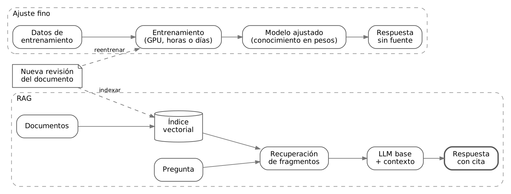
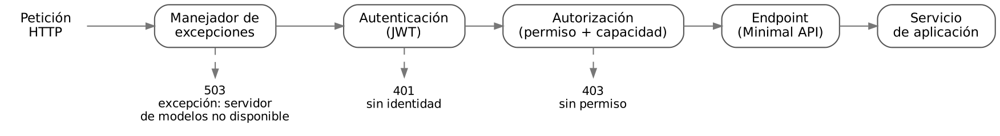

#+title: Diseño e implementación de un asistente conversacional basado en Generación Aumentada por Recuperación (RAG) para la consulta de documentación controlada en un sistema ERP de gestión de calidad
#+subtitle: Reporte final de residencia profesional
#+author: Alberto Emiliano Solis Santos
#+date: 2026
#+language: es
#+options: toc:t num:t
#+latex_header: \usepackage[spanish,es-tabla]{babel}
#+latex_header: \usepackage[margin=2.5cm]{geometry}
#+latex_header: \usepackage{tabularx}
#+latex_header: \usepackage{array}
#+latex_header: \usepackage{float}
#+latex_header: \usepackage{xurl}
#+latex_header: \newcolumntype{Y}{>{\raggedright\arraybackslash}X}
#+latex_header_extra: \hypersetup{hidelinks}
#+property: header-args:dot :eval no-export :exports results :cmdline -Tpng -Gdpi=150

# Borrador 1 (2026-11-23). Estructura basada en el formato habitual de reporte
# final de residencia profesional del TecNM. Confirmar con el asesor interno si
# la institución pide otra plantilla.
# Regla de confidencialidad: solo información pública de la empresa (su sitio web); no incluir clientes, códigos
# de documentos, nombres de módulos, esquemas de base de datos ni código fuente.
# Diagramas: bloques Graphviz (dot). Para regenerarlos: instalar Graphviz, habilitar
# (org-babel-do-load-languages 'org-babel-load-languages '((dot . t))) y C-c C-c en cada bloque.
# Las imágenes ya generadas están en figuras/.

#+TOC: tables
#+latex: \listoffigures

* Pendientes antes de entregar                                    :noexport:
- [ ] Confirmar con el asesor interno la estructura y extensión exigidas.
- [ ] PENDIENTE: confirmar si la empresa permite publicar las mediciones del prototipo (sección [[*Resultados]]).
- [ ] Nombre del asesor externo y periodo de la residencia.
- [ ] Comprobar cada referencia; solo Taipalus (2024) está verificada contra el original. Las URL de Microsoft Learn y demás documentación se escribieron de memoria: abrir cada una y poner la fecha de consulta.
- [ ] Verificar la tabla comparativa de bases vectoriales contra la documentación oficial y citarla con fecha de consulta.
- [ ] Completar resultados de recall@10 y llamado a herramientas.
- [ ] Redactar agradecimientos, actividades sociales y competencias desarrolladas.

* Datos generales
| Residente       | Alberto Emiliano Solis Santos                  |
| Empresa         | G-ONE Auto Parts de México, S.A. de C.V.       |
| Área            | Tecnologías de la Información (TI)             |
| Asesor interno  | Juan Pablo Valencia Aguirre                    |
| Asesor externo  | /[Pendiente]/                                  |
| Periodo         | /[Pendiente]/                                  |

* Agradecimientos
/[Por redactar.]/

* Resumen
Las organizaciones de manufactura que operan bajo sistemas de gestión de calidad acumulan cientos de documentos controlados: procedimientos, instructivos y planes de inspección, con frecuencia en más de un idioma y con múltiples revisiones vigentes y obsoletas. Localizar la instrucción correcta exige conocer el código del documento o recorrerlo manualmente.

Este reporte presenta el diseño e implementación de un asistente conversacional integrado a un sistema ERP de gestión de calidad, basado en la arquitectura de Generación Aumentada por Recuperación (RAG). Se eligió RAG sobre el ajuste fino porque no requiere reentrenar el modelo, incorpora documentos nuevos en cuanto se emiten y permite citar la fuente exacta de cada respuesta. El contenido de cada revisión se fragmenta, se convierte en vectores de 1024 dimensiones con un modelo de embeddings abierto y se almacena junto con los datos transaccionales; la búsqueda usa similitud coseno con el control de acceso aplicado dentro de la misma consulta. La generación se ejecuta con un modelo de lenguaje abierto servido localmente, sin enviar información a servicios externos.

La evaluación propone medir la calidad de recuperación con recall@10 sobre un conjunto de preguntas reales anonimizadas en dos idiomas, y la confiabilidad del llamado a herramientas como proporción de invocaciones con esquema válido. /[Completar con resultados finales.]/

*Palabras clave:* generación aumentada por recuperación, modelos de lenguaje, bases de datos vectoriales, búsqueda semántica, gestión de calidad, ERP.

* Generalidades del proyecto
** Introducción
Los sistemas de gestión de calidad en la industria manufacturera, como los basados en ISO 9001 o IATF 16949, exigen que cada operación se realice conforme a un documento controlado en su revisión vigente. Los sistemas ERP centralizan esos documentos, pero su consulta sigue dependiendo de búsquedas por código, título o palabra exacta.

Los modelos de lenguaje de gran escala (LLM) permiten formular preguntas en lenguaje natural, pero por sí solos desconocen la documentación interna de una organización y pueden generar respuestas plausibles pero falsas (alucinaciones). La arquitectura RAG (Lewis et al., 2020) resuelve ambas limitaciones al recuperar primero los fragmentos relevantes y entregarlos al modelo como contexto.

El presente reporte describe el trabajo realizado durante la residencia profesional: el análisis de alternativas, el diseño de la solución, su implementación incremental y el protocolo con el que se evalúa.

** Descripción de la empresa y del área de trabajo
*** La empresa
G-ONE Auto Parts de México, S.A. de C.V. es un fabricante especializado en partes de la estructura de la carrocería automotriz. Su propósito declarado es fabricar una carrocería ligera y altamente rígida en cooperación con sus empresas matrices en Japón (G-ONE Auto Parts de México, s.f.-a). La empresa surge de la unión de dos fabricantes de autopartes; se estableció en el estado de Guanajuato en 2012 y comenzó operaciones en 2014.

Su producción diaria se rige por el lema "alta calidad, precio razonable y oportuno". Su política de calidad establece metas mensuales cuantificadas, entre ellas cero casos de calidad de rango A y B, y cero paros de línea del cliente por entregas (G-ONE Auto Parts de México, s.f.-b).

*** Relación de la empresa con el proyecto
Tres rasgos de la empresa explican requisitos del asistente:

1. *Documentación en dos idiomas.* La cooperación con las matrices en Japón hace que parte de la documentación controlada exista en español y en japonés. Por ello la evaluación incluye preguntas en ambos idiomas.
2. *Exigencia de calidad.* Con metas de cero casos de calidad graves, una respuesta basada en una revisión obsoleta no es aceptable. De ahí los requisitos de trazabilidad y de indexar por revisión.
3. *Seguridad de la información.* La política de seguridad de la información de la empresa compromete la confidencialidad, integridad y disponibilidad de la información y el cumplimiento de los controles de ISO/IEC 27001 (G-ONE Auto Parts de México, s.f.-b). Por ello los modelos se ejecutan en servidores propios y ningún documento se envía a servicios externos.

*** Área de trabajo
La residencia se realizó en el departamento de Tecnologías de la Información (TI) de la empresa, que desarrolla el sistema ERP de gestión de calidad. Ese sistema administra, entre otros procesos, el control documental: la emisión, revisión, aprobación y difusión de documentos controlados.

El residente se integró al equipo de desarrollo, con la responsabilidad de construir la capa de acceso a modelos de lenguaje y las funciones de búsqueda semántica y asistente. El despliegue en servidores lo realizó un desarrollador senior del equipo.

/[Se omiten los detalles internos del sistema, sus documentos y sus datos por confidencialidad.]/

** Problemas a resolver, priorizados
En un entorno de calidad, una respuesta incorrecta no es solo un mal resultado: puede convertirse en evidencia falsa. Responder con una revisión obsoleta de un procedimiento, o con un documento que el usuario no tiene permiso de ver, tiene consecuencias de auditoría. Por ello el problema no es únicamente "responder preguntas sobre documentos", sino hacerlo con tres garantías, en orden de prioridad:

1. *Trazabilidad:* cada afirmación debe citar el documento, la revisión y la ubicación (página, hoja o fila) de donde proviene.
2. *Control de acceso:* la recuperación no debe revelar contenido fuera del alcance del usuario ni de su organización.
3. *Confidencialidad:* los documentos no deben salir de la infraestructura de la organización hacia servicios de terceros.

De este planteamiento se derivan cuatro preguntas que guían el proyecto:

- *P1.* ¿Es RAG una alternativa más adecuada que el ajuste fino para adaptar un LLM a documentación controlada que cambia con cada revisión?
- *P2.* ¿Qué tipo de almacenamiento vectorial (sistema dedicado o extensión de un motor relacional) satisface mejor los requisitos de exactitud, aislamiento y control de acceso?
- *P3.* ¿Qué tamaño de modelo de lenguaje es suficiente para responder con citas y llamar herramientas de forma confiable en hardware local con una sola GPU?
- *P4.* ¿Qué métrica de similitud (euclidiana, coseno o producto interno) conviene para comparar embeddings de texto?

** Objetivos
*** Objetivo general
Diseñar, implementar y evaluar un asistente conversacional basado en RAG que responda preguntas sobre la documentación controlada de un ERP de calidad, con citas verificables y respetando el control de acceso.

*** Objetivos específicos
1. Analizar las alternativas de adaptación de LLM (ajuste fino y RAG) y justificar la elección.
2. Comparar sistemas de bases de datos vectoriales y seleccionar uno con base en criterios técnicos.
3. Implementar un proceso de indexación que fragmente, vectorice y almacene el contenido de cada revisión.
4. Implementar la búsqueda semántica con el control de acceso integrado en la consulta.
5. Implementar la generación de respuestas con citas mediante un modelo servido localmente.
6. Evaluar la calidad de recuperación y la confiabilidad del llamado a herramientas.

** Justificación
El ajuste fino requiere conjuntos de entrenamiento, cómputo considerable y reentrenar cada vez que un documento cambia, lo que lo hace costoso en tiempo para documentación que se revisa continuamente. RAG evita el entrenamiento, refleja una nueva revisión en cuanto se indexa y, al conservar el texto recuperado, permite mostrar la fuente. La inferencia local elimina el riesgo de enviar documentos a proveedores externos.

** Alcances y limitaciones
- Se indexa el contenido en prosa de documentos controlados. Los datos estructurados (registros, matrices, capturas de inspección) se excluyen porque ya se consultan con consultas exactas, y sustituir una respuesta exacta por una aproximada sería un retroceso.
- El asistente propone y consulta, pero no modifica registros por sí mismo.
- La evaluación se limita a español y japonés, los idiomas de la documentación del caso de estudio.
- La inferencia está limitada por una sola GPU compartida, lo que restringe la concurrencia.

* Marco teórico
El marco teórico se divide en dos partes: los fundamentos de modelos de lenguaje y recuperación semántica, que sustentan la elección de RAG, y las tecnologías de desarrollo con las que se implementó el asistente.

** Fundamentos de modelos de lenguaje y recuperación semántica
*** Modelos de lenguaje de gran escala
Un LLM es una red neuronal basada en la arquitectura Transformer (Vaswani et al., 2017) que, entrenada sobre grandes corpus, predice el siguiente token de una secuencia. Su conocimiento queda fijo en los pesos al terminar el entrenamiento, y su ventana de contexto limita cuánta información adicional puede recibir en una consulta.

El tamaño del modelo, medido en miles de millones de parámetros (B), determina su capacidad de razonamiento y la memoria de GPU que requiere. Un modelo de 27B en precisión cuantizada de 4 bits ocupa del orden de 15 a 18 GB, lo que deja poco margen en una GPU de 24 GB para la caché de atención (/KV cache/) y, por tanto, para atender varias consultas en paralelo. El tamaño adecuado no se elige por intuición sino midiendo, con el mismo conjunto de preguntas, cuál es el modelo más pequeño que cumple la tarea (véase [[*Resultados]]).

*** Embeddings de texto
Un embedding es un vector de números reales de dimensión fija que representa el significado de un texto, de modo que textos con significado similar quedan cerca en el espacio vectorial. Los modelos de embeddings actuales son multilingües: una pregunta en español puede quedar cerca de su respuesta escrita en japonés.

Dos propiedades son relevantes para el diseño:
- *La dimensión es una decisión de esquema.* Cambiar de modelo puede cambiar la dimensión y obliga a revectorizar todo el corpus, por lo que debe validarse antes de fijarla.
- *Asimetría consulta-documento.* Muchos modelos esperan un prefijo de instrucción en la consulta pero no en el documento. Omitirlo no produce un error: degrada la recuperación en silencio.

*** Métricas de similitud
Sean dos vectores \(\mathbf{a}\) y \(\mathbf{b}\) de dimensión \(n\). La *distancia euclidiana* mide la longitud del segmento que los une:

\[ d_E(\mathbf{a},\mathbf{b}) = \sqrt{\sum_{i=1}^{n} (a_i - b_i)^2} \]

La *similitud coseno* mide el ángulo entre ellos e ignora su magnitud:

\[ \cos(\mathbf{a},\mathbf{b}) = \frac{\mathbf{a}\cdot\mathbf{b}}{\lVert\mathbf{a}\rVert\,\lVert\mathbf{b}\rVert} \]

Cuando los vectores están normalizados a longitud 1, ambas medidas ordenan los resultados de la misma forma, porque:

\[ d_E(\mathbf{a},\mathbf{b})^2 = 2 - 2\cos(\mathbf{a},\mathbf{b}) \]

En ese caso el producto interno coincide con el coseno y es la operación más barata. Taipalus (2024) señala además que en dimensiones altas las distancias euclidianas tienden a concentrarse, lo que reduce su poder de discriminación; por eso los modelos de embeddings de texto suelen entrenarse y evaluarse con coseno. Este proyecto usa distancia coseno.

La tabla [[tab:metricas]] resume las métricas.

#+name: tab:metricas
#+caption: Métricas de similitud entre vectores.
#+attr_latex: :environment tabularx :width \textwidth :align lllY :placement [H]
| Métrica              | Fórmula                                                                            | Rango                | Interpretación                                              |
|----------------------+------------------------------------------------------------------------------------+----------------------+-------------------------------------------------------------|
| Distancia euclidiana | \(\lVert\mathbf{a}-\mathbf{b}\rVert\)                                              | \([0,\infty)\)       | Menor es más parecido; sensible a la magnitud               |
| Similitud coseno     | \(\frac{\mathbf{a}\cdot\mathbf{b}}{\lVert\mathbf{a}\rVert\lVert\mathbf{b}\rVert}\) | \([-1,1]\)           | Mayor es más parecido; solo considera el ángulo             |
| Distancia coseno     | \(1-\cos(\mathbf{a},\mathbf{b})\)                                                  | \([0,2]\)            | Forma de distancia del coseno; la usa el motor para ordenar |
| Producto interno     | \(\mathbf{a}\cdot\mathbf{b}\)                                                      | \((-\infty,\infty)\) | Igual al coseno si los vectores están normalizados          |

*** Ajuste fino frente a RAG
Existen dos formas principales de especializar un LLM en un dominio (tabla [[tab:ft-rag]]).

#+name: tab:ft-rag
#+attr_latex: :environment tabularx :width \textwidth :align lYY :placement [H]
#+caption: Comparación entre ajuste fino y RAG para documentación controlada.
| Criterio                     | Ajuste fino (fine-tuning)                   | RAG                                   |
|------------------------------+---------------------------------------------+---------------------------------------|
| Entrenamiento                | Requiere datos etiquetados y cómputo de GPU | No requiere entrenar                  |
| Documento nuevo o revisado   | Reentrenar                                  | Indexar el documento                  |
| Cita de la fuente            | No es posible: el conocimiento queda en los pesos | El fragmento recuperado se muestra |
| Control de acceso por usuario | No es posible filtrar lo aprendido         | Se filtra en la recuperación          |
| Riesgo de alucinación        | Persiste                                    | Se reduce al anclar al contexto       |
| Costo principal              | Entrenamiento                               | Almacenamiento e indexación           |

Para documentación controlada, los criterios de cita y control de acceso son decisivos: un modelo ajustado no puede demostrar de qué revisión proviene una respuesta ni olvidar lo que un usuario no debe ver.

La figura [[fig:rag-vs-ft]] muestra la diferencia práctica: ante una nueva revisión, el ajuste fino exige volver a entrenar, mientras que RAG solo indexa el documento.

#+name: dot-rag-vs-ft
#+begin_src dot :file figuras/rag-vs-ft.png
digraph ragft {
  graph [fontname="Helvetica", fontsize=11, nodesep=0.35, ranksep=0.45, bgcolor="white"];
  node [shape=box, style="rounded", fontname="Helvetica", fontsize=11, color="#555555", margin="0.18,0.08"];
  edge [color="#777777", fontname="Helvetica", fontsize=9, arrowsize=0.7];
  rankdir=LR;
  subgraph cluster_ft { label="Ajuste fino"; labeljust=l; style="rounded,dashed"; color="#999999";
    d1 [label="Datos de\nentrenamiento"]; t1 [label="Entrenamiento\n(GPU, horas o días)"]; m1 [label="Modelo ajustado\n(conocimiento en pesos)"]; r1 [label="Respuesta\nsin fuente"];
    d1 -> t1 -> m1 -> r1; }
  subgraph cluster_rag { label="RAG"; labeljust=l; style="rounded,dashed"; color="#999999";
    d2 [label="Documentos"]; i2 [label="Índice\nvectorial", shape=cylinder]; p2 [label="Pregunta"]; s2 [label="Recuperación\nde fragmentos"]; m2 [label="LLM base\n+ contexto"]; r2 [label="Respuesta\ncon cita", style="rounded,bold"];
    d2 -> i2 -> s2; p2 -> s2 -> m2 -> r2; }
  rev [label="Nueva revisión\ndel documento", shape=note];
  rev -> t1 [label=" reentrenar", style=dashed];
  rev -> i2 [label=" indexar", style=dashed];
}
#+end_src

#+name: fig:rag-vs-ft
#+caption: Flujo de ajuste fino frente a RAG ante una nueva revisión documental.
#+attr_latex: :width \textwidth :placement [H]
#+RESULTS: dot-rag-vs-ft

*** Fragmentación de documentos
Los documentos se dividen en fragmentos (/chunks/) porque el modelo de embeddings tiene un límite de tokens y porque un vector de un documento completo diluye su significado. Las estrategias comunes son por tamaño fijo con traslape, por estructura (títulos, párrafos, filas de tabla) y semánticas. Cada fragmento debe conservar un *ancla*: la página, hoja o fila de origen, que es lo que convierte la respuesta en una cita verificable.

*** Búsqueda de vecinos más cercanos
La búsqueda exacta (k-NN) compara la consulta con todos los vectores: su costo crece linealmente pero el resultado es exacto. Los índices aproximados (ANN) como HNSW (Malkov y Yashunin, 2018), los basados en cuantización de producto (Jégou et al., 2011) o en hashing sensible a la localidad sacrifican exactitud por velocidad. Taipalus (2024) indica que los índices sin pérdida se prefieren cuando la exactitud es crítica.

*** Sistemas gestores de bases de datos vectoriales
Taipalus (2024) distingue tres familias: los *sistemas vectoriales dedicados* (Pinecone, Qdrant, Milvus, Weaviate, Chroma), los *sistemas multimodelo o con extensión vectorial* sobre un motor existente (PostgreSQL con pgvector, Redis, MongoDB) y las *bibliotecas* de búsqueda como FAISS, que no ofrecen funciones propias de un gestor (transacciones, persistencia, control de acceso). Las consultas híbridas, que combinan similitud vectorial con filtros sobre metadatos, son el caso típico en aplicaciones empresariales.

La figura [[fig:taxonomia]] resume esa clasificación.

#+name: dot-taxonomia
#+begin_src dot :file figuras/taxonomia.png
digraph tax {
  graph [fontname="Helvetica", fontsize=11, nodesep=0.35, ranksep=0.45, bgcolor="white"];
  node [shape=box, style="rounded", fontname="Helvetica", fontsize=11, color="#555555", margin="0.18,0.08"];
  edge [color="#777777", fontname="Helvetica", fontsize=9, arrowsize=0.7];
  rankdir=TB;
  root [label="Sistemas de búsqueda vectorial", style="rounded,bold"];
  a [label="SGBD vectoriales\ndedicados"]; b [label="SGBD multimodelo o\ncon extensión vectorial"]; c [label="Bibliotecas\nde búsqueda"];
  a1 [label="Pinecone · Qdrant\nMilvus · Weaviate\nChroma", shape=plaintext]; b1 [label="PostgreSQL + pgvector\nRedis · MongoDB\nSQL Server 2025", shape=plaintext]; c1 [label="FAISS", shape=plaintext];
  root -> {a b c}; a -> a1; b -> b1; c -> c1;
}
#+end_src

#+name: fig:taxonomia
#+caption: Clasificación de los sistemas de búsqueda vectorial. Elaboración propia con base en Taipalus (2024); SQL Server 2025 se agrega como extensión vectorial.
#+attr_latex: :width 0.8\textwidth :placement [H]
#+RESULTS: dot-taxonomia
[[file:figuras/taxonomia.png]]

*** Llamado a herramientas
Los LLM recientes pueden emitir, en lugar de texto, una invocación estructurada (JSON) a una función declarada por la aplicación. Esto permite que el asistente consulte el índice o datos exactos del sistema. La aplicación debe validar el esquema de cada llamada y verificar que el usuario tenga permiso para la herramienta invocada.

** Tecnologías de desarrollo
El asistente se construyó dentro de un sistema existente, por lo que su diseño quedó determinado tanto por los fundamentos de IA anteriores como por la plataforma de desarrollo del sistema. Esta sección describe esas tecnologías y los conceptos de ingeniería de software en que se apoya la implementación.

*** Plataforma .NET y lenguaje C#
.NET es una plataforma de desarrollo de código abierto y multiplataforma mantenida por Microsoft, que incluye un entorno de ejecución administrado (CLR), una biblioteca base de clases y herramientas de compilación (Microsoft, s.f.-a). El proyecto usa .NET 10, versión con soporte a largo plazo (LTS), y el lenguaje C#, de tipado estático y orientado a objetos con elementos funcionales.

Tres características del lenguaje fueron relevantes en el proyecto:
- *Tipos de referencia anulables:* el compilador advierte cuando un valor puede ser nulo y no se comprueba, lo que reduce errores en tiempo de ejecución.
- *Registros (=record=) y miembros obligatorios (=required=):* permiten definir objetos inmutables para las peticiones y respuestas, y obligan a quien los crea a llenar los campos esenciales. En el asistente, por ejemplo, el propósito de una petición de embedding (consulta o documento) es obligatorio, de modo que olvidar la asimetría descrita en la sección de embeddings produce un error de compilación en lugar de una degradación silenciosa.
- *Programación asíncrona (=async=/=await=):* las llamadas al servidor de modelos y a la base de datos son operaciones de entrada y salida; hacerlas asíncronas libera el hilo mientras se espera la respuesta y permite cancelarlas con un =CancellationToken= cuando el cliente se desconecta.

*** Analizadores de código
Los analizadores de Roslyn, el compilador de C#, inspeccionan el código durante la compilación y reportan problemas de calidad, seguridad o estilo (Microsoft, s.f.-b). En el proyecto se configuraron como errores y no como avisos, de modo que el código no compila mientras no cumpla las reglas. Además se usó un analizador de API prohibidas para impedir llamadas a métodos considerados inseguros dentro del sistema.

*** ASP.NET Core
ASP.NET Core es el marco de trabajo de .NET para construir aplicaciones web y API HTTP (Microsoft, s.f.-c). Una aplicación se arma en dos fases: primero se registran los servicios en un contenedor de dependencias y después se configura la /canalización de middleware/, una cadena de componentes por la que pasa cada petición (autenticación, autorización, manejo de errores, enrutamiento) antes de llegar al código que la atiende.

*** API REST y endpoints
REST (/Representational State Transfer/) es un estilo de arquitectura para sistemas distribuidos en el que los recursos se identifican con URL y se manipulan con los métodos de HTTP (Fielding, 2000). Un /endpoint/ es la combinación de una ruta y un método HTTP que la aplicación expone, por ejemplo =POST /api/v1/assistant/search=.

El asistente expone tres endpoints agrupados bajo un mismo prefijo versionado:

#+attr_latex: :environment tabularx :width \textwidth :align llY :placement [H]
#+caption: Endpoints del asistente.
| Método | Ruta relativa    | Función                                                                  |
|--------+------------------+--------------------------------------------------------------------------|
| GET    | =/availability=  | Indica si hay modelo configurado, para que la interfaz no ofrezca una función que fallaría |
| POST   | =/search=        | Búsqueda semántica: devuelve fragmentos con documento, revisión y ancla  |
| POST   | =/ask=           | Pregunta en lenguaje natural: devuelve una respuesta con citas           |

Se agruparon bajo el prefijo del asistente, y no bajo el de documentos, porque lo que se habilita o restringe por organización es la capacidad de inteligencia artificial: una organización con documentos pero sin modelo tendría un endpoint que siempre falla.

*** Controladores frente a Minimal APIs
ASP.NET Core ofrece dos formas de definir endpoints (Microsoft, s.f.-d):
- *Controladores:* clases que heredan de =ControllerBase=, donde cada método público es una acción asociada a una ruta mediante atributos. Es el modelo tradicional MVC.
- *Minimal APIs:* los endpoints se declaran como funciones (/lambdas/) asociadas a una ruta con métodos como =MapGet= y =MapPost=, y se organizan en grupos de rutas (=MapGroup=) que comparten prefijo, autorización y filtros.

El sistema usa Minimal APIs. Tienen menos código de infraestructura, las dependencias se reciben directamente como parámetros de cada función y el grupo de rutas permite aplicar en un solo lugar la autorización y la restricción por capacidad contratada. El siguiente ejemplo genérico ilustra la forma:

#+begin_src csharp
var grupo = app.MapGroup("/api/v1/asistente")
               .RequireAuthorization();

grupo.MapPost("/buscar", async (PeticionBusqueda peticion,
                                IServicioBusqueda servicio,
                                CancellationToken ct) =>
{
    var resultados = await servicio.BuscarAsync(
        peticion.Pregunta, peticion.Cantidad, ct);
    return Results.Ok(resultados);
});
#+end_src

*** Autenticación, autorización y manejo de errores
Las peticiones se autentican con /JSON Web Tokens/ (JWT), un formato estándar de credencial firmada que transporta la identidad del usuario y su organización (Jones et al., 2015). Sobre esa identidad se aplican dos controles: un permiso por acción (buscar requiere un permiso más amplio que preguntar, porque preguntar ocupa la GPU compartida) y una capacidad contratada por organización.

Los errores se devuelven con el formato /Problem Details/ para API HTTP (Nottingham et al., 2023). Cuando el servidor de modelos no responde, un manejador de excepciones traduce el error a una respuesta =503 Service Unavailable=, que distingue "el servicio no está disponible ahora" de un error del sistema.

La figura [[fig:middleware]] muestra el recorrido de una petición al asistente y la tabla [[tab:http]] los códigos de respuesta que puede recibir.

#+name: dot-middleware
#+begin_src dot :file figuras/middleware.png
digraph mw {
  graph [fontname="Helvetica", fontsize=11, nodesep=0.35, ranksep=0.45, bgcolor="white"];
  node [shape=box, style="rounded", fontname="Helvetica", fontsize=11, color="#555555", margin="0.18,0.08"];
  edge [color="#777777", fontname="Helvetica", fontsize=9, arrowsize=0.7];
  rankdir=LR;
  p [label="Petición\nHTTP", shape=plaintext]; e [label="Manejador de\nexcepciones"]; au [label="Autenticación\n(JWT)"]; az [label="Autorización\n(permiso + capacidad)"]; en [label="Endpoint\n(Minimal API)"]; s [label="Servicio\nde aplicación"];
  r401 [label="401\nsin identidad", shape=plaintext, fontsize=10]; r403 [label="403\nsin permiso", shape=plaintext, fontsize=10]; r503 [label="503\nexcepción: servidor\nde modelos no disponible", shape=plaintext, fontsize=10];
  p -> e -> au -> az -> en -> s [weight=10];
  au -> r401 [style=dashed]; az -> r403 [style=dashed]; e -> r503 [style=dashed];
  { rank=same; e; r503; } { rank=same; au; r401; } { rank=same; az; r403; }
}
#+end_src

#+name: fig:middleware
#+caption: Canalización de middleware de una petición al asistente.
#+attr_latex: :width \textwidth :placement [H]
#+RESULTS: dot-middleware

#+name: tab:http
#+caption: Códigos de respuesta HTTP del asistente.
#+attr_latex: :environment tabularx :width \textwidth :align llY :placement [H]
| Código | Nombre              | Cuándo se devuelve                                                                            |
|--------+---------------------+-----------------------------------------------------------------------------------------------|
| 200    | OK                  | La búsqueda o la respuesta se generó correctamente                                            |
| 400    | Bad Request         | La petición no cumple el formato (por ejemplo, pregunta vacía)                                |
| 401    | Unauthorized        | No hay token válido                                                                           |
| 403    | Forbidden           | El usuario no tiene el permiso de buscar o preguntar                                          |
| 404    | Not Found           | La organización no tiene contratada la capacidad de IA: el grupo de rutas no existe para ella |
| 503    | Service Unavailable | El servidor de modelos no responde o está ocupado                                             |

*** Documentación con OpenAPI
OpenAPI es una especificación estándar para describir API HTTP en un documento legible por máquinas (OpenAPI Initiative, 2024). ASP.NET Core genera ese documento a partir de los endpoints declarados, lo que permite probarlos y generar clientes sin escribir la documentación a mano.

*** Inyección de dependencias y configuración
La /inyección de dependencias/ consiste en que un componente recibe los servicios que necesita en lugar de crearlos, lo que permite sustituirlos en pruebas o cambiar su implementación sin modificar a quien los usa (Fowler, 2004). .NET incluye un contenedor de dependencias en el que cada servicio se registra con un tiempo de vida: único para toda la aplicación (/singleton/), uno por petición (/scoped/) o uno nuevo cada vez (/transient/).

La configuración del modelo (direcciones del servidor, nombres de modelos, dimensión de los vectores) se lee de archivos JSON y variables de entorno mediante el /patrón Options/, que la convierte en un objeto tipado y la valida al iniciar. Si la sección está vacía, el sistema interpreta que la instalación no tiene modelo, un estado válido en el que el resto del ERP sigue funcionando.

#+name: tab:di
#+caption: Tiempos de vida en el contenedor de dependencias de .NET.
#+attr_latex: :environment tabularx :width \textwidth :align lYY :placement [H]
| Tiempo de vida | Instancias                               | Uso típico                                                                |
|----------------+------------------------------------------+---------------------------------------------------------------------------|
| Singleton      | Una para toda la aplicación              | Configuración validada, fábrica de clientes HTTP                          |
| Scoped         | Una por petición o por mensaje procesado | Contexto de base de datos (DbContext), contexto de la organización actual |
| Transient      | Una nueva cada vez que se pide           | Servicios ligeros sin estado                                              |

*** Cliente HTTP hacia el servidor de modelos
La comunicación con Ollama se hace por su API REST: =/api/embed= para obtener embeddings y =/api/chat= para generar respuestas con herramientas (Ollama, s.f.). Se usó =IHttpClientFactory=, que administra la reutilización de conexiones y evita el agotamiento de sockets que ocurre al crear y desechar clientes HTTP repetidamente (Microsoft, s.f.-e). Se registraron dos clientes con nombre, uno por cada instancia de Ollama (interactiva y diferida), cada uno con su propio límite de tiempo.

*** Entity Framework Core y LINQ
Entity Framework Core (EF Core) es el mapeador objeto-relacional (ORM) de .NET: traduce clases de C# a tablas y consultas escritas en LINQ a SQL (Microsoft, s.f.-f). LINQ (/Language Integrated Query/) permite escribir consultas con la sintaxis del propio lenguaje, verificadas por el compilador.

El proyecto usa EF Core 10, que puede expresar la distancia vectorial dentro de una consulta LINQ. Esto permitió escribir en una sola sentencia el filtro de acceso, el filtro de idioma y el ordenamiento por distancia coseno, que es la propiedad que se discute en la sección de seguridad en la recuperación. Dos detalles de EF Core condicionaron el diseño:
- *Propiedades en la sombra:* el vector se mapeó como una propiedad que existe en el modelo de EF pero no en la clase de dominio, para que el dominio no dependa de un tipo propio del proveedor de base de datos.
- *Orden de las operaciones:* ordenar después de proyectar el resultado a otro tipo no se puede traducir a SQL; el ordenamiento debe ir antes de la proyección.

*** SQL Server y el tipo vectorial nativo
SQL Server es el sistema gestor de bases de datos relacional del sistema. Su versión 2025 incorpora un tipo de dato =vector= de dimensión fija y la función =VECTOR_DISTANCE=, que calcula distancia coseno, euclidiana o de producto punto (Microsoft, s.f.-g). Esto permitió guardar los embeddings en la misma base que los documentos, con integridad referencial hacia la revisión de la que provienen.

El aislamiento entre organizaciones se apoya en la *seguridad a nivel de fila* (/Row-Level Security/, RLS): predicados definidos en la base de datos que filtran automáticamente las filas según un valor de contexto de la sesión, en este caso la organización del usuario (Microsoft, s.f.-h). Como el filtro lo aplica el motor, una consulta mal escrita en la aplicación no puede leer datos de otra organización.

*** Arquitectura en capas y puertos y adaptadores
El sistema sigue una arquitectura limpia (Martin, 2017) organizada en capas:
- *Dominio:* entidades y reglas de negocio, sin dependencias externas.
- *Aplicación:* casos de uso y los /puertos/, interfaces que declaran lo que la aplicación necesita del exterior.
- *Infraestructura:* los /adaptadores/ que implementan esos puertos con una tecnología concreta (base de datos, servidor de modelos, archivos).

Es el patrón de puertos y adaptadores, o arquitectura hexagonal (Cockburn, 2005). En el asistente, el acceso al modelo de lenguaje se declaró como un puerto independiente del proveedor, y Ollama es solo uno de sus adaptadores; cambiar de servidor de inferencia no afecta a los casos de uso.

El sistema es además un /monolito modular/: una sola aplicación desplegable dividida en módulos con fronteras explícitas, en el que cada módulo es dueño de sus datos. Por eso el asistente declara el contrato de una herramienta, pero cada módulo implementa las herramientas sobre sus propios datos.

La figura [[fig:capas]] muestra el sentido de las dependencias: todas apuntan hacia el dominio, y la infraestructura depende de la aplicación porque implementa sus puertos.

#+name: dot-capas
#+begin_src dot :file figuras/capas.png
digraph capas {
  graph [fontname="Helvetica", fontsize=11, nodesep=0.35, ranksep=0.45, bgcolor="white"];
  node [shape=box, style="rounded", fontname="Helvetica", fontsize=11, color="#555555", margin="0.18,0.08"];
  edge [color="#777777", fontname="Helvetica", fontsize=9, arrowsize=0.7];
  rankdir=TB;
  api [label="API (ASP.NET Core)\nendpoints Minimal API"]; worker [label="Worker Service\nprocesos en segundo plano"];
  app [label="Aplicación\ncasos de uso + puertos (interfaces)"];
  dom [label="Dominio\nentidades y reglas", style="rounded,filled", fillcolor="#e3eefb", color="#2b6cb0"];
  infra [label="Infraestructura\nadaptadores: EF Core, Ollama, Open XML, PdfPig"];
  ext [label="SQL Server · Ollama · archivos", shape=cylinder];
  api -> app; worker -> app; app -> dom; infra -> app [label=" implementa puertos", style=dashed]; infra -> dom; infra -> ext;
  { rank=same; api; worker; }
}
#+end_src

#+name: fig:capas
#+caption: Capas de la arquitectura y sentido de sus dependencias.
#+attr_latex: :width 0.85\textwidth :placement [H]
#+RESULTS: dot-capas
[[file:figuras/capas.png]]

*** Diseño guiado por el dominio
Del diseño guiado por el dominio (/Domain-Driven Design/, Evans, 2003) se tomó el concepto de /agregado/: un grupo de objetos que se modifica como una unidad a través de una raíz. El conjunto de fragmentos de una revisión es un agregado: reindexar sustituye todos sus fragmentos en una sola operación, y la raíz lleva los datos de auditoría.

*** Patrón outbox y procesos en segundo plano
El /patrón outbox/ resuelve el problema de guardar un cambio y publicar un evento de forma consistente: el evento se escribe en una tabla de la misma base de datos, dentro de la misma transacción que el cambio, y un proceso aparte lo lee y lo entrega después (Richardson, 2018). Así no puede existir un documento emitido cuyo evento de indexación se haya perdido.

Ese proceso aparte es un /Worker Service/ de .NET: una aplicación sin interfaz que ejecuta servicios en segundo plano (=BackgroundService=) de forma continua (Microsoft, s.f.-i). El indexado y las tareas encargadas al asistente se ejecutan ahí, con su propia instancia de Ollama, para no competir con las consultas interactivas.

La figura [[fig:outbox]] muestra el patrón aplicado a la indexación: si el manejador falla, el evento sigue pendiente y se reintenta.

#+name: dot-outbox
#+begin_src dot :file figuras/outbox.png
digraph outbox {
  graph [fontname="Helvetica", fontsize=11, nodesep=0.35, ranksep=0.45, bgcolor="white"];
  node [shape=box, style="rounded", fontname="Helvetica", fontsize=11, color="#555555", margin="0.18,0.08"];
  edge [color="#777777", fontname="Helvetica", fontsize=9, arrowsize=0.7];
  rankdir=LR;
  subgraph cluster_tx { label="Una sola transacción"; labeljust=l; style="rounded,dashed"; color="#999999";
    c [label="Guardar cambio\n(emitir revisión)"]; o [label="Escribir evento\nen tabla outbox"]; c -> o; }
  w [label="Worker lee\neventos pendientes"]; h [label="Manejador\nde indexación"]; m [label="Marcar evento\ncomo procesado"];
  o -> w -> h -> m;
  h -> w [label=" falla: reintento", style=dashed, constraint=false];
}
#+end_src

#+name: fig:outbox
#+caption: Patrón outbox aplicado a la indexación de una revisión.
#+attr_latex: :width \textwidth :placement [H]
#+RESULTS: dot-outbox
[[file:figuras/outbox.png]]

*** Extracción de texto de documentos
Para extraer el texto de los documentos se usaron dos bibliotecas de código abierto:
- *Open XML SDK*, para archivos de procesador de texto y hojas de cálculo en formato Office Open XML, estándar ISO/IEC 29500 (Microsoft, s.f.-j).
- *PdfPig*, para leer el texto y su página de origen en archivos PDF (PdfPig, s.f.).

Ambas permiten conservar el ancla de cada fragmento: página en PDF, hoja y fila en hojas de cálculo.

*** Pruebas automatizadas
Las pruebas se escribieron con xUnit, un marco de pruebas para .NET (xUnit.net, s.f.), en tres niveles (tabla [[tab:pruebas]]).

#+name: tab:pruebas
#+caption: Niveles de pruebas automatizadas.
#+attr_latex: :environment tabularx :width \textwidth :align lYY :placement [H]
| Nivel           | Qué verifica                                                                   | Ejemplo en el asistente                                              |
|-----------------+--------------------------------------------------------------------------------+----------------------------------------------------------------------|
| Unitarias       | Una clase aislada, con sus dependencias sustituidas                            | El cliente de Ollama con respuestas HTTP simuladas                   |
| De arquitectura | Reglas de diseño, inspeccionando los ensamblados compilados mediante reflexión | Que ninguna capa de dominio referencie tipos de la base de datos     |
| De integración  | El comportamiento contra una base de datos real                                | Que la consulta vectorial se traduzca a SQL y respete el aislamiento |

La cobertura se midió con Coverlet.

** Trabajos relacionados
/[Pendiente de investigación bibliográfica. Sugerencias: Lewis et al. (2020) como trabajo fundacional; Gao et al. (2023) como revisión de RAG; estudios de RAG en manufactura, salud o ámbito legal, donde la trazabilidad también es requisito; Es et al. (2024) sobre evaluación de RAG (RAGAS).]/

* Procedimiento y descripción de las actividades realizadas
** Metodología
El desarrollo siguió un enfoque incremental en cuatro entregas, cada una con pruebas automatizadas que debían pasar antes de la siguiente:

1. Acceso al modelo de lenguaje.
2. Indexación.
3. Búsqueda semántica con cita.
4. Asistente con citas y herramientas.

Las restricciones de diseño se verificaron además con pruebas de arquitectura que impiden, por ejemplo, que la capa de dominio dependa de tipos de la base de datos.

/[Agregar cronograma de actividades por semana o mes, si el formato lo pide.]/

** Requisitos
#+attr_latex: :environment tabularx :width \textwidth :align lY :placement [H]
#+caption: Requisitos funcionales y no funcionales.
| Tipo          | Requisito                                                                       |
|---------------+---------------------------------------------------------------------------------|
| Funcional     | Indexar automáticamente cada revisión al emitirse                               |
| Funcional     | Buscar por significado y devolver fragmentos con documento, revisión y ancla    |
| Funcional     | Responder en lenguaje natural citando las fuentes                               |
| Funcional     | Invocar herramientas declaradas por cada módulo del sistema                     |
| No funcional  | Ningún documento sale de la infraestructura propia                              |
| No funcional  | La búsqueda respeta el alcance de lectura del usuario y la organización         |
| No funcional  | La ausencia del servidor de modelos no rompe el resto del sistema               |
| No funcional  | Respuesta de búsqueda en menos de 200 ms con 10,000 vectores por organización   |

** Selección del almacenamiento vectorial
Las opciones investigadas (Qdrant, Pinecone y pgvector) se compararon con un cuarto candidato: el tipo vectorial nativo que ya incorporan algunos motores relacionales comerciales.

#+attr_latex: :environment tabularx :width \textwidth :align lYYYY :placement [H] :font \footnotesize
#+caption: Comparación de opciones de almacenamiento vectorial. Verificar contra la documentación oficial antes de entregar.
| Criterio                         | Qdrant                     | Pinecone                        | pgvector                     | Tipo vectorial del motor existente |
|----------------------------------+----------------------------+---------------------------------+------------------------------+------------------------------------|
| Familia (Taipalus, 2024)         | Dedicado                   | Dedicado                        | Extensión de PostgreSQL      | Extensión del motor                |
| Despliegue                       | Autoalojado o nube         | Servicio administrado en la nube | Autoalojado                 | Autoalojado, mismo servidor        |
| Licencia                         | Código abierto (Apache 2.0) | Propietaria                    | Código abierto               | La del motor                       |
| Búsqueda exacta                  | Sí                         | Orientado a aproximada          | Sí                           | Sí                                 |
| Índice aproximado                | HNSW                       | Propio                          | HNSW, IVFFlat                | Según versión                      |
| Filtro por metadatos             | Filtros de carga útil      | Filtros de metadatos            | SQL completo                 | SQL completo                       |
| Transacciones con datos del ERP  | No                         | No                              | Solo si el ERP usa PostgreSQL | Sí                                |
| Datos fuera de la organización   | No, si se autoaloja        | Sí                              | No                           | No                                 |

Se eligió el tipo vectorial del motor relacional que ya usa el ERP, por estas razones:

1. *Confidencialidad:* descarta servicios administrados en la nube.
2. *Aislamiento entre organizaciones:* el ERP es multiempresa y ya aplica seguridad a nivel de fila en el motor; un sistema externo obligaría a replicar esa regla en un segundo lugar.
3. *Consistencia:* el fragmento y la revisión documental viven en la misma base, con integridad referencial; al marcar una revisión como obsoleta no hay un segundo sistema que sincronizar.
4. *Filtrado dentro de la consulta:* el alcance de lectura del usuario entra en la misma sentencia que el orden por distancia (véase [[*Seguridad en la recuperación]]).
5. *Escala suficiente:* el volumen por organización (decenas de miles de fragmentos) permite búsqueda exacta sin índice aproximado.

La decisión tiene costo: se renuncia a la escalabilidad horizontal de un sistema dedicado. Si el corpus creciera en órdenes de magnitud, Qdrant sería la alternativa autoalojada natural.

** Arquitectura general
El asistente se organiza en dos flujos que comparten el almacén vectorial: uno asíncrono de indexación y uno interactivo de consulta (figura [[fig:arquitectura]]).

#+name: dot-arquitectura
#+begin_src dot :file figuras/arquitectura.png
digraph arquitectura {
  graph [fontname="Helvetica", fontsize=11, nodesep=0.35, ranksep=0.45, bgcolor="white"];
  node [shape=box, style="rounded", fontname="Helvetica", fontsize=11, color="#555555", margin="0.18,0.08"];
  edge [color="#777777", fontname="Helvetica", fontsize=9, arrowsize=0.7];
  rankdir=LR; newrank=true;
  subgraph cluster_idx { label="Indexación (segundo plano)"; labeljust=l; style="rounded,dashed"; color="#999999";
    emit [label="Revisión emitida\n(evento outbox)"]; frag [label="Fragmentar\n(texto + ancla)"]; vecd [label="Vectorizar\n(embeddings, CPU)"]; }
  store [label="Almacén vectorial\n(BD relacional)", shape=cylinder, style="filled", fillcolor="#e3eefb", color="#2b6cb0"];
  subgraph cluster_q { label="Consulta (interactiva)"; labeljust=l; style="rounded,dashed"; color="#999999";
    q [label="Pregunta\ndel usuario"]; vecq [label="Vectorizar\n(prefijo de consulta)"]; search [label="Búsqueda coseno\ncon filtro de acceso"]; llm [label="LLM local\n(Ollama, GPU)"]; ans [label="Respuesta con citas\n(documento, revisión, ancla)", style="rounded,bold"]; }
  emit -> frag -> vecd -> store;
  q -> vecq -> search -> llm -> ans;
  store -> search [label=" k fragmentos", style=dashed];
  { rank=same; vecd; search; }
}
#+end_src

#+name: fig:arquitectura
#+caption: Arquitectura del asistente: dos flujos que comparten un almacén vectorial.
#+attr_latex: :width \textwidth :placement [H]
#+RESULTS: dot-arquitectura
[[file:figuras/arquitectura.png]]

** Proceso de indexación
1. La emisión de una revisión publica un evento en una bandeja de salida transaccional (patrón /outbox/), procesado por un servicio en segundo plano.
2. Se extrae el texto según el formato (procesador de texto, hoja de cálculo o PDF) y se registra el tipo de extracción, porque el texto obtenido por reconocimiento visual puede contener errores.
3. Se fragmenta conservando el ancla de cada fragmento y su número de tokens.
4. Se calcula un /hash/ del archivo fuente: si no cambió, no se vuelve a vectorizar.
5. Se vectoriza cada fragmento y se guarda el conjunto identificado por revisión, idioma y modelo de embeddings, de modo que reindexar sea idempotente y que dos modelos de igual dimensión nunca se mezclen.
6. Si el servidor de modelos no está disponible, el proceso termina sin error y lo registra, en lugar de reintentar indefinidamente.

El índice pertenece a la *revisión*, no al documento: responder con un procedimiento obsoleto sería evidencia falsa.

** Proceso de consulta y generación con citas
1. La pregunta se vectoriza con el prefijo de instrucción de consulta.
2. Se recuperan los /k/ fragmentos más cercanos por distancia coseno, dentro del alcance del usuario.
3. Se construye el contexto respetando un presupuesto de tokens.
4. El LLM genera la respuesta indicando qué fragmento respalda cada afirmación; la aplicación verifica que cada cita corresponda a un fragmento efectivamente recuperado.
5. Opcionalmente, el modelo invoca herramientas; cada invocación se valida contra su esquema y contra los permisos del usuario.

** Seguridad en la recuperación
Un hallazgo del diseño fue que filtrar *después* de ordenar por distancia produce resultados incompletos de forma silenciosa. En una prueba, pedir los 10 más cercanos y luego filtrar por permisos dejó 6 resultados; incluir el filtro en la misma consulta que el ordenamiento entregó los 10. El número perdido depende de quién pregunta, sin que nadie lo note. Por ello el alcance de lectura se aplica dentro de la consulta (prefiltrado) y el aislamiento entre organizaciones se delega a la seguridad a nivel de fila del motor.

La figura [[fig:filtrado]] compara ambas estrategias.

#+name: dot-filtrado
#+begin_src dot :file figuras/filtrado.png
digraph filtrado {
  graph [fontname="Helvetica", fontsize=11, nodesep=0.35, ranksep=0.45, bgcolor="white"];
  node [shape=box, style="rounded", fontname="Helvetica", fontsize=11, color="#555555", margin="0.18,0.08"];
  edge [color="#777777", fontname="Helvetica", fontsize=9, arrowsize=0.7];
  rankdir=LR;
  subgraph cluster_post { label="Post-filtrado (descartado)"; labeljust=l; style="rounded,dashed"; color="#999999";
    a1 [label="Ordenar por distancia\ny tomar 10"]; a2 [label="Filtrar por\npermisos"]; a3 [label="6 resultados", style="rounded,filled", fillcolor="#fde2e1", color="#c53030"]; a1 -> a2 -> a3; }
  subgraph cluster_pre { label="Pre-filtrado (elegido)"; labeljust=l; style="rounded,dashed"; color="#999999";
    b1 [label="Filtrar por permisos\ne idioma"]; b2 [label="Ordenar por distancia\ny tomar 10"]; b3 [label="10 resultados", style="rounded,filled", fillcolor="#e1f5e4", color="#2f855a"]; b1 -> b2 -> b3; }
}
#+end_src

#+name: fig:filtrado
#+caption: Post-filtrado frente a pre-filtrado en la búsqueda vectorial, con 10 resultados pedidos.
#+attr_latex: :width 0.8\textwidth :placement [H]
#+RESULTS: dot-filtrado
[[file:figuras/filtrado.png]]

Para tareas en segundo plano, la identidad de quien solicitó viaja con la tarea y sus permisos se resuelven *al ejecutar*, no al encolar: si un rol se revoca entre ambos momentos, la tarea falla y lo informa.

** Despliegue local del modelo
Los modelos se sirven con Ollama en dos instancias sobre el mismo servidor: una interactiva con GPU para preguntas y búsquedas, y otra diferida en CPU para indexación continua. El servidor de inferencia, y no la aplicación, serializa el acceso a la GPU mediante su cola. Se verifica que el modelo cabe completo en la GPU, porque un reparto entre CPU y GPU degrada la latencia sin producir errores. La configuración de referencia usa un modelo de embeddings abierto de 0.6B parámetros con vectores de 1024 dimensiones y un generador abierto de alrededor de 27B parámetros, ambos sujetos a la evaluación de la sección de resultados.

#+name: tab:ollama
#+caption: Instancias del servidor de inferencia.
#+attr_latex: :environment tabularx :width \textwidth :align lYYY :placement [H]
| Instancia   | Hardware | Uso                                     | Consultas en paralelo |
|-------------+----------+-----------------------------------------+-----------------------|
| Interactiva | GPU      | Preguntas y búsquedas de los usuarios   | 2, con cola de espera |
| Diferida    | CPU      | Indexación continua y tareas encargadas | 1                     |

La excepción es el primer indexado masivo de todos los documentos, que se ejecuta en GPU porque en CPU tomaría horas.

#+name: tab:parametros
#+caption: Parámetros de referencia del asistente.
#+attr_latex: :environment tabularx :width \textwidth :align lY :placement [H]
| Parámetro                  | Valor                                 |
|----------------------------+---------------------------------------|
| Modelo de embeddings       | Abierto, 0.6B parámetros, multilingüe |
| Dimensión de los vectores  | 1024                                  |
| Métrica                    | Distancia coseno                      |
| Tipo de búsqueda           | Exacta (sin índice aproximado)        |
| Fragmentos recuperados (k) | 10                                    |
| Modelo generador           | Abierto, alrededor de 27B parámetros  |
| Servidor de inferencia     | Ollama, en servidores propios         |

** Implementación
/[Esqueleto; describir sin copiar código propietario. Usar pseudocódigo cuando haga falta.]/
- *Tecnologías:* plataforma de desarrollo, motor relacional, Ollama, modelos abiertos usados y sus licencias.
- *Capa de acceso al modelo:* puertos independientes del proveedor (embeddings y chat), límite de tiempo y error de "ocupado" distinguible.
- *Almacenamiento vectorial:* el vector como tipo de infraestructura que no contamina el dominio; consulta de distancia expresada en el ORM.
- *Indexación en segundo plano:* patrón /outbox/, idempotencia y purga de revisiones obsoletas.
- *Asistente y herramientas:* catálogo cerrado de herramientas, cada una con su permiso; validación de citas.
- *Pruebas:* unitarias, de arquitectura e integración; qué verifica cada nivel.

* Resultados
** Desempeño del almacenamiento vectorial (resultados preliminares)
Mediciones del prototipo en un entorno de pruebas con 20,000 vectores de 1024 dimensiones repartidos en dos organizaciones.

#+attr_latex: :environment tabularx :width \textwidth :align Yr :placement [H]
#+caption: Mediciones preliminares del almacenamiento vectorial.
| Medición                                              | Resultado  |
|-------------------------------------------------------+------------|
| Espacio en disco, 20,000 vectores                     | 157 MB     |
| 10 vecinos más cercanos sobre 10,000 vectores visibles | 16 a 20 ms |
| Proyección lineal a 200,000 vectores                  | ~340 ms    |
| Fuga entre organizaciones con filtro inconsistente    | 0 filas    |

** Calidad de recuperación
Conjunto de al menos 20 preguntas reales anonimizadas, la mitad en japonés, cada una con el fragmento esperado. Métrica: recall@10, cambiando solo el modelo de embeddings. La mitad en japonés prueba el modo de fallo multilingüe: una pregunta en español puede recuperar el fragmento correcto pero en el idioma equivocado.

\[ \text{recall@}k = \frac{\lvert \text{relevantes} \cap \text{recuperados}_k \rvert}{\lvert \text{relevantes} \rvert} \]

/[Resultados pendientes.]/

** Confiabilidad del llamado a herramientas
Proporción de 50 intentos con esquema válido, cambiando solo el modelo generador. Responde la pregunta P3 sobre el tamaño del modelo. /[Resultados pendientes.]/

** Latencia de generación
Tokens por segundo y uso de GPU por modelo. /[Resultados pendientes.]/

** Discusión
/[Responder P1 a P4 con base en los resultados.]/

* Actividades sociales realizadas en la empresa
/[Por redactar, si aplica.]/

* Conclusiones, recomendaciones y experiencia profesional adquirida
** Conclusiones
/[Cumplimiento de cada objetivo específico.]/

** Recomendaciones y trabajo futuro
- La cola de inferencia no reparte de forma equitativa entre organizaciones en el camino interactivo; conviene estudiar un mecanismo de equidad.
- La búsqueda exacta está limitada en escala; incorporar un índice aproximado cuando el volumen lo justifique.
- Historial de conversaciones.
- Lectura de imágenes (evidencia fotográfica y documentos escaneados).
- Búsqueda híbrida léxica y semántica, y reordenamiento (/reranking/) de resultados.

** Experiencia profesional adquirida
/[Por redactar.]/

* Competencias desarrolladas y/o aplicadas
/[Por redactar. Ejemplos: diseño de arquitectura de software, integración de modelos de lenguaje, bases de datos vectoriales, pruebas automatizadas, seguridad y control de acceso.]/

* Fuentes de información
Cockburn, A. (2005). /Hexagonal architecture/. Alistair Cockburn. https://alistair.cockburn.us/hexagonal-architecture/

Evans, E. (2003). /Domain-driven design: Tackling complexity in the heart of software/. Addison-Wesley.

Fielding, R. T. (2000). /Architectural styles and the design of network-based software architectures/ [Tesis doctoral, University of California, Irvine].

Fowler, M. (2004). /Inversion of control containers and the dependency injection pattern/. https://martinfowler.com/articles/injection.html

Gao, Y., Xiong, Y., Gao, X., Jia, K., Pan, J., Bi, Y., Dai, Y., Sun, J., Wang, M., & Wang, H. (2023). /Retrieval-augmented generation for large language models: A survey/. arXiv. https://arxiv.org/abs/2312.10997

G-ONE Auto Parts de México. (s.f.-a). /Inicio/. Recuperado el 23 de noviembre de 2026, de https://www.g-one.com.mx/

G-ONE Auto Parts de México. (s.f.-b). /Políticas/. Recuperado el 23 de noviembre de 2026, de https://www.g-one.com.mx/policies

Jégou, H., Douze, M., & Schmid, C. (2011). Product quantization for nearest neighbor search. /IEEE Transactions on Pattern Analysis and Machine Intelligence, 33/(1), 117–128.

Jones, M., Bradley, J., & Sakimura, N. (2015). /JSON Web Token (JWT)/ (RFC 7519). Internet Engineering Task Force. https://doi.org/10.17487/RFC7519

Lewis, P., Perez, E., Piktus, A., Petroni, F., Karpukhin, V., Goyal, N., Küttler, H., Lewis, M., Yih, W., Rocktäschel, T., Riedel, S., & Kiela, D. (2020). Retrieval-augmented generation for knowledge-intensive NLP tasks. /Advances in Neural Information Processing Systems, 33/, 9459–9474.

Malkov, Y. A., & Yashunin, D. A. (2018). Efficient and robust approximate nearest neighbor search using hierarchical navigable small world graphs. /IEEE Transactions on Pattern Analysis and Machine Intelligence, 42/(4), 824–836.

Martin, R. C. (2017). /Clean architecture: A craftsman's guide to software structure and design/. Prentice Hall.

Microsoft. (s.f.-a). /Introducción a .NET/. Microsoft Learn. Recuperado el [fecha], de https://learn.microsoft.com/es-es/dotnet/core/introduction

Microsoft. (s.f.-b). /Información general sobre el análisis de código fuente de .NET/. Microsoft Learn. Recuperado el [fecha], de https://learn.microsoft.com/es-es/dotnet/fundamentals/code-analysis/overview

Microsoft. (s.f.-c). /Información general de ASP.NET Core/. Microsoft Learn. Recuperado el [fecha], de https://learn.microsoft.com/es-es/aspnet/core/introduction-to-aspnet-core

Microsoft. (s.f.-d). /Elegir entre API basadas en controladores y API mínimas/. Microsoft Learn. Recuperado el [fecha], de https://learn.microsoft.com/es-es/aspnet/core/fundamentals/apis

Microsoft. (s.f.-e). /IHttpClientFactory con .NET/. Microsoft Learn. Recuperado el [fecha], de https://learn.microsoft.com/es-es/dotnet/core/extensions/httpclient-factory

Microsoft. (s.f.-f). /Entity Framework Core: información general/. Microsoft Learn. Recuperado el [fecha], de https://learn.microsoft.com/es-es/ef/core/

Microsoft. (s.f.-g). /Tipo de datos vector/. Microsoft Learn. Recuperado el [fecha], de https://learn.microsoft.com/es-es/sql/t-sql/data-types/vector-data-type

Microsoft. (s.f.-h). /Seguridad de nivel de fila/. Microsoft Learn. Recuperado el [fecha], de https://learn.microsoft.com/es-es/sql/relational-databases/security/row-level-security

Microsoft. (s.f.-i). /Servicios de trabajo en .NET/. Microsoft Learn. Recuperado el [fecha], de https://learn.microsoft.com/es-es/dotnet/core/extensions/workers

Microsoft. (s.f.-j). /Open XML SDK/. Microsoft Learn. Recuperado el [fecha], de https://learn.microsoft.com/es-es/office/open-xml/open-xml-sdk

Nottingham, M., Wilde, E., & Dalal, S. (2023). /Problem details for HTTP APIs/ (RFC 9457). Internet Engineering Task Force. https://doi.org/10.17487/RFC9457

Ollama. (s.f.). /Ollama API/ [Documentación]. GitHub. Recuperado el [fecha], de https://github.com/ollama/ollama/blob/main/docs/api.md

OpenAPI Initiative. (2024). /OpenAPI Specification/ (versión 3.1.1). https://spec.openapis.org/oas/v3.1.1

PdfPig. (s.f.). /PdfPig/ [Software]. GitHub. Recuperado el [fecha], de https://github.com/UglyToad/PdfPig

pgvector. (s.f.). /pgvector: Open-source vector similarity search for Postgres/ [Software]. GitHub. Recuperado el [fecha], de https://github.com/pgvector/pgvector

Pinecone Systems. (s.f.). /Pinecone/. Recuperado el [fecha], de https://www.pinecone.io/

Qdrant. (s.f.). /Qdrant: Vector database/. Recuperado el [fecha], de https://qdrant.tech/

Richardson, C. (2018). /Microservices patterns: With examples in Java/. Manning.

Taipalus, T. (2024). Vector database management systems: Fundamental concepts, use-cases, and current challenges. /Cognitive Systems Research, 85/, Artículo 101216. https://doi.org/10.1016/j.cogsys.2024.101216

Vaswani, A., Shazeer, N., Parmar, N., Uszkoreit, J., Jones, L., Gomez, A. N., Kaiser, Ł., & Polosukhin, I. (2017). Attention is all you need. /Advances in Neural Information Processing Systems, 30/.

xUnit.net. (s.f.). /xUnit.net/ [Software]. Recuperado el [fecha], de https://xunit.net/

* Anexos
** Glosario
- *ANN:* búsqueda aproximada de vecinos más cercanos.
- *Embedding:* representación vectorial del significado de un texto.
- *LLM:* modelo de lenguaje de gran escala.
- *Outbox:* patrón que registra eventos en la misma transacción que el cambio que los origina, para procesarlos después.
- *Endpoint:* combinación de ruta y método HTTP que expone una API.
- *JWT:* credencial firmada que transporta la identidad del usuario.
- *ORM:* mapeador objeto-relacional.
- *RAG:* generación aumentada por recuperación.
- *RLS:* seguridad a nivel de fila en la base de datos.
- *Recall@k:* proporción de fragmentos relevantes que aparecen entre los /k/ primeros resultados.

** Protocolo de evaluación
/[Detallar el procedimiento de las pruebas de recuperación y de llamado a herramientas.]/

** Preguntas de prueba anonimizadas
/[Incluir solo preguntas sin datos de la empresa.]/
